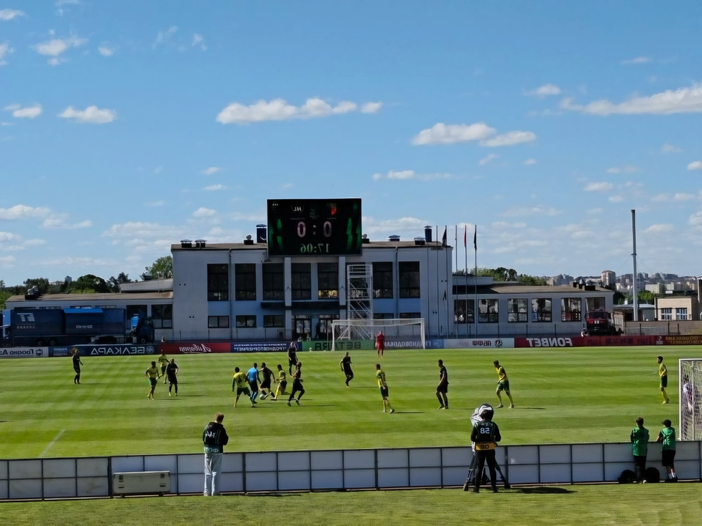
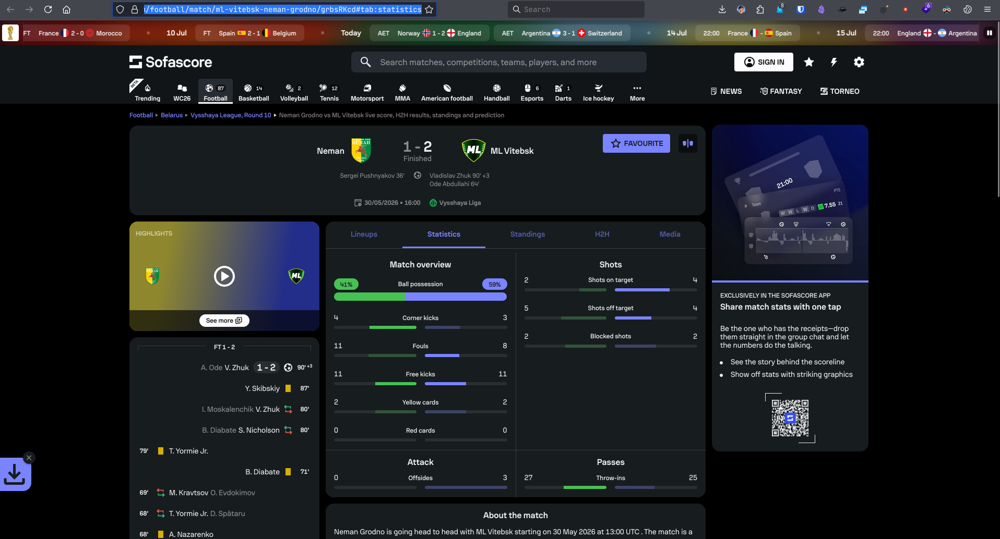
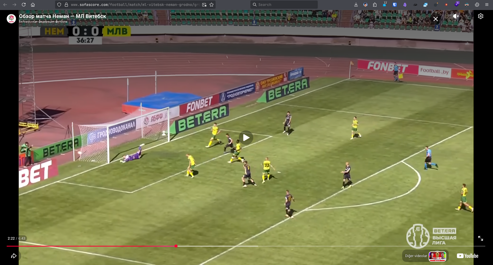

# Junior Crypt 2026 CTF - `FOOTBALLchik` Writeup

- **Author:** Efe Şahinbaş
- **GitHub Repository:** [MacallanTheRoot/ctf-writeups](https://github.com/MacallanTheRoot/ctf-writeups/)
- **Category:** OSINT
- **Target:** `FOOTBALLchik.jpg`
- **Flag format:** `grodno{MM:SS}`

## Challenge Description

```text
At the end of spring, I decided to go to a football match and took this photo.

Find the exact time the first goal was scored.

Flag format: grodno{MM:SS}
```

## Summary

I investigated the stadium and pitch details in the supplied photograph with reverse image search. The image was traced to the Neman Grodno - ML Vitebsk match played at the Neman Central Sports Complex in Grodno on May 30, 2026.

After confirming the fixture on SofaScore, I reviewed the match highlights. The broadcast clock showed `36:27` when the first goal was scored.

## 1. Initial Image Analysis

The challenge image shows a football pitch, a distinctive grandstand, and a large scoreboard. The score is still `0-0` at the moment captured in the photograph.



Reverse image search and venue research produced the following match:

```text
Venue: Neman Central Sports Complex, Grodno, Belarus
Match: Neman Grodno vs. ML Vitebsk
Date: May 30, 2026
```

## 2. Confirming the Match

The fixture was confirmed on SofaScore. The page showed the Neman versus ML Vitebsk match and its `1-2` final score.



This identified the correct match, but the challenge requested an exact `MM:SS` timestamp. A rounded event minute from a match timeline was therefore not sufficient.

## 3. Finding the First Goal

I opened the match highlights and moved to the first scoring play. At the goal, the broadcast match clock displayed:

```text
36:27
```



## Flag

```text
grodno{36:27}
```

## Solution Chain

```text
Challenge photograph
  -> identify the stadium and city
  -> match Neman Grodno vs. ML Vitebsk
  -> confirm the fixture on SofaScore
  -> inspect the first goal in the highlights
  -> 36:27
```
