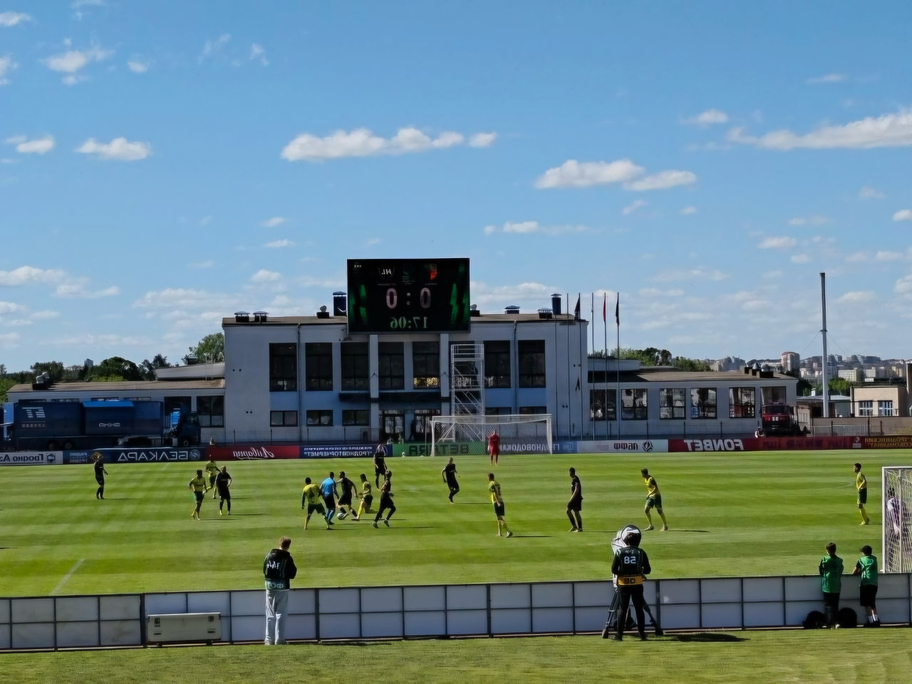
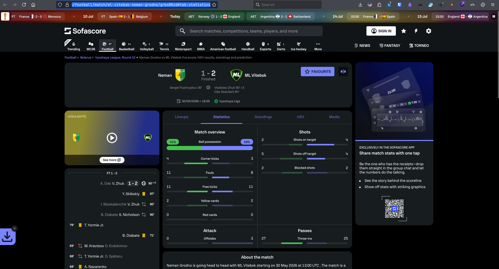
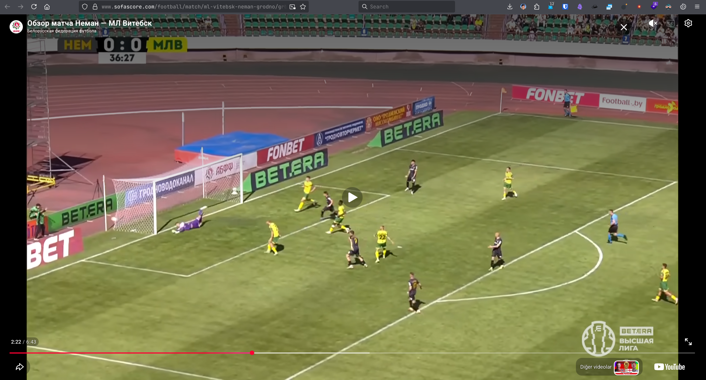

# Junior Crypt 2026 CTF - `FOOTBALLchik` Writeup

- **Yazar:** Efe Şahinbaş
- **GitHub Deposu:** [MacallanTheRoot/ctf-writeups](https://github.com/MacallanTheRoot/ctf-writeups/)
- **Kategori:** OSINT
- **Hedef:** `FOOTBALLchik.jpg`
- **Flag formatı:** `grodno{MM:SS}`

## Soru Açıklaması

```text
At the end of spring, I decided to go to a football match and took this photo.

Find the exact time the first goal was scored.

Flag format: grodno{MM:SS}
```

## Özet

Verilen fotoğraftaki stadyum ve saha ayrıntıları tersine görsel arama ile araştırıldı. Görüntünün 30 Mayıs 2026 tarihinde Grodno'daki Neman Merkez Spor Kompleksi'nde oynanan Neman Grodno - ML Vitebsk karşılaşmasına ait olduğu belirlendi.

Maç SofaScore üzerinde doğrulandıktan sonra özet videosu incelendi. İlk gol sırasında maç saati `36:27` değerini gösteriyordu.

## 1. İlk Görsel İncelemesi

Challenge görselinde futbol sahası, tribün yapısı ve büyük bir skor tabelası görülüyor. Tabelada skor henüz `0-0` ve maç devam ediyor.



Fotoğraf üzerinde yapılan tersine görsel arama ve mekân araştırması şu eşleşmeyi verdi:

```text
Stadyum: Neman Merkez Spor Kompleksi, Grodno, Belarus
Maç: Neman Grodno - ML Vitebsk
Tarih: 30 Mayıs 2026
```

## 2. Maçın Doğrulanması

Eşleşme SofaScore maç sayfasında doğrulandı. Sayfa Neman ile ML Vitebsk arasındaki karşılaşmayı ve `1-2` final skorunu gösteriyordu.



Bu adım doğru maçın bulunduğunu kesinleştirdi, ancak challenge ilk golün yalnızca dakikasını değil tam `MM:SS` değerini istiyordu. Bu nedenle olay listesindeki yuvarlanmış dakika bilgisi yeterli değildi.

## 3. İlk Golün Zamanı

Maçın özet videosu açılarak ilk gol pozisyonuna gidildi. Gol anında yayın grafiğindeki maç saati şu değeri gösteriyordu:

```text
36:27
```



## Flag

```text
grodno{36:27}
```

## Çözüm Zinciri

```text
Challenge fotoğrafı
  -> stadyum ve şehir tespiti
  -> Neman Grodno - ML Vitebsk maç eşleşmesi
  -> SofaScore ile doğrulama
  -> özet videosunda ilk gol
  -> 36:27
```
