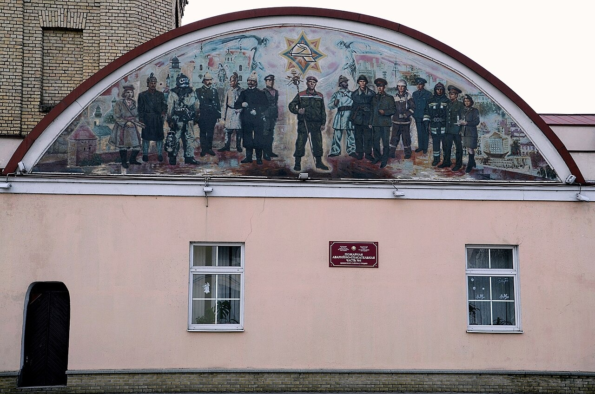

# Junior Crypt 2026 CTF - `Grodno Mural Artist` Writeup

- **Writeup Author:** Efe Sahinbas
- **GitHub Repository:** [MacallanTheRoot/ctf-writeups](https://github.com/MacallanTheRoot/ctf-writeups/)

**Category:** OSINT  
**Challenge file:** `artifact.jpg`  
**Flag format:** `grodno{FirstName_LastName}`

---

## Challenge Description

The challenge provides a photo of an actual site in Grodno and asks for the first and last name of the artist who created the monumental mural on the facade of the building.

---

## Summary

The image shows the fire station / fire tower complex in Grodno, Belarus. The plaque on the facade identifies it as a fire and rescue unit, and the large semicircular mural above the facade shows firefighters from different historical periods.

Searching for the Grodno fire tower/fire station mural leads to references naming the mural as a work by Grodno artist Vladimir Kachan.

Final flag:

```text
grodno{Vladimir_Kachan}
```

---

## 1. Reading the Image

The provided image:



Important visual clues:

- A historic brick fire tower on the left
- A fire/rescue plaque on the facade
- A large semicircular mural above the building
- Firefighter figures from different eras
- Cyrillic text on the plaque

The plaque text and the mural theme point to a fire station, not a generic museum or church facade.

---

## 2. Identifying the Site

Searching around the visible context with terms such as:

```text
Grodno fire station mural facade
Grodno fire tower mural firefighters
Гродно пожарная каланча роспись фасада художник
Гродно пожарная часть фреска художник
```

identifies the place as the Grodno fire tower / fire station complex.

The relevant building is associated with the Museum of Fire Service History in Grodno and the active fire station complex near the fire tower.

---

## 3. Finding the Artist

Once the site is identified, the next search target becomes the mural itself rather than the building:

```text
Владимир Качан пожарная часть Гродно роспись
монументальная роспись Огнеборцы история и традиции мужества
```

References for the Grodno fire tower mention that the large semicircular pediment of the fire station contains a mural by Grodno artist V. Kachan.

The artist biography for Vladimir Kachan also lists the monumental mural:

```text
Огнеборцы - история и традиции мужества
```

on the facade of the Museum of Fire Service History in Grodno.

So the first and last name required by the flag format is:

```text
Vladimir Kachan
```

---

## 4. Flag

```text
grodno{Vladimir_Kachan}
```

---

## Key Takeaway

For OSINT image challenges, the best path is often:

```text
visible institution -> exact site -> artwork name -> artist
```

Here, the fire station context made the mural searchable, and the mural attribution gave the artist.
