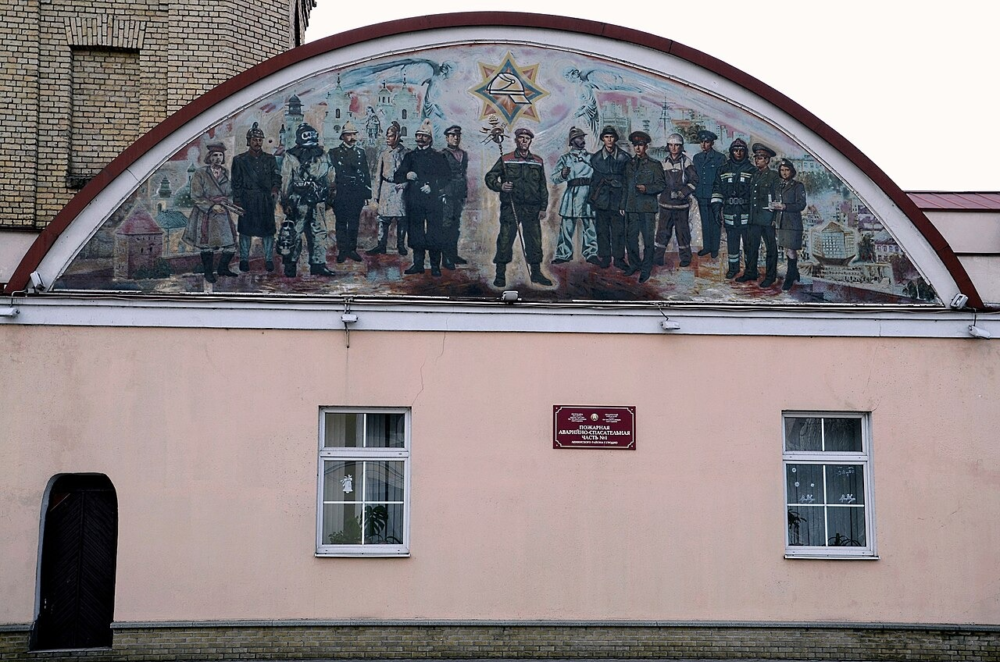

# Junior Crypt 2026 CTF - `Fire Mural` Writeup

- **Writeup Yazarı:** Efe Sahinbas
- **GitHub Deposu:** [MacallanTheRoot/ctf-writeups](https://github.com/MacallanTheRoot/ctf-writeups/)

**Kategori:** OSINT  
**Challenge dosyası:** `artifact.jpg`  
**Flag formatı:** `grodno{FirstName_LastName}`

---

## Challenge Açıklaması

Author: @vvanuss
easy

The image shows an actual site in Grodno.
Identify the first and last name of the artist who created the monumental mural on the facade of this building.

Flag format: grodno{FirstName_LastName}
---

## Özet

Görsel, Belarus'un Grodno şehrindeki yangın kulesi / itfaiye kompleksiyle eşleşiyor. Cephedeki tabela yapının yangın ve kurtarma birimi olduğunu gösteriyor. Üstteki büyük yarım daire biçimli mural ise farklı tarihsel dönemlerden itfaiyecileri gösteriyor.

Grodno yangın kulesi ve itfaiye cephesindeki mural üzerine yapılan aramalar, eserin Grodno'lu sanatçı Vladimir Kachan tarafından yapıldığını gösteriyor.

Final flag:

```text
grodno{Vladimir_Kachan}
```

---

## 1. Görseli Okumak

Verilen görsel:



Dikkat çeken ipuçları:

- Sol tarafta tarihi tuğla yangın kulesi
- Cephede yangın/kurtarma birimi tabelası
- Yapının üstünde büyük yarım daire biçimli mural
- Farklı dönemlerden itfaiyeci figürleri
- Tabelada Kiril alfabesiyle yazı

Tabela ve mural teması, yapının sıradan bir müze veya kilise değil; itfaiye ile ilgili bir yapı olduğunu gösteriyor.

---

## 2. Yapıyı Tespit Etmek

Görseldeki bağlamdan yola çıkarak şu tarz aramalar yapılabilir:

```text
Grodno fire station mural facade
Grodno fire tower mural firefighters
Гродно пожарная каланча роспись фасада художник
Гродно пожарная часть фреска художник
```

Bu aramalar yapıyı Grodno'daki yangın kulesi / itfaiye kompleksi olarak tespit etmeyi sağlıyor.

İlgili yapı, Grodno Yangın Hizmeti Tarihi Müzesi ve aktif itfaiye kompleksiyle bağlantılı.

---

## 3. Sanatçıyı Bulmak

Yapı tespit edildikten sonra arama artık binanın kendisine değil, cephedeki mural'a odaklanmalı:

```text
Владимир Качан пожарная часть Гродно роспись
монументальная роспись Огнеборцы история и традиции мужества
```

Grodno yangın kulesiyle ilgili kaynaklarda, itfaiye binasının büyük yarım daire biçimli alınlığındaki rоспись/mural için Grodno'lu sanatçı V. Kachan adı veriliyor.

Vladimir Kachan biyografisinde de Grodno Yangın Hizmeti Tarihi Müzesi cephesindeki monumental mural şu isimle geçiyor:

```text
Огнеборцы - история и традиции мужества
```

Bu yüzden flag formatı için gereken ad ve soyad:

```text
Vladimir Kachan
```

---

## 4. Flag

```text
grodno{Vladimir_Kachan}
```

---

## Çıkarım

OSINT görsel sorularında çoğu zaman en verimli yol şu sırayı izlemek:

```text
görünen kurum -> kesin yapı -> eser adı -> sanatçı
```

Bu soruda itfaiye bağlamı mural'ı aranabilir hale getirdi; mural atfı da sanatçıyı verdi.
