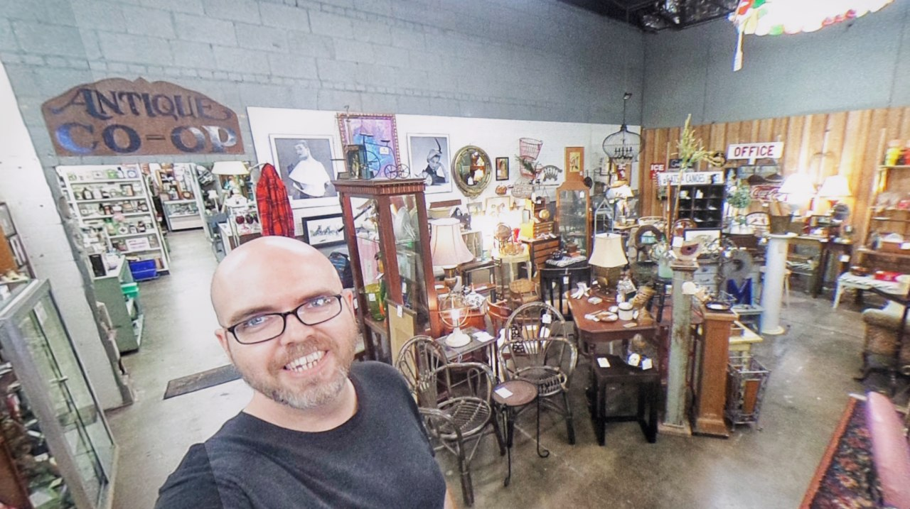

# Junior Crypt 2026 CTF - `WhoAmI` Writeup

- **Author:** Efe Şahinbaş
- **GitHub Repository:** [MacallanTheRoot/ctf-writeups](https://github.com/MacallanTheRoot/ctf-writeups/)
- **Category:** OSINT
- **Target:** `WhoAmI.jpg`
- **Flag format:** `grodno{FirstName_LastName}`

## Challenge Description

```text
While traveling through Oklahoma, I stumbled upon an interesting shop and took
this selfie. Can you figure out my name?

Flag format: grodno{FirstName_LastName}
```

## Summary

Ordinary reverse image searches focused on the shop and furniture in the challenge photograph and did not identify the person. I therefore switched to face search. PimEyes returned two portraits that appeared to show the same person. A separate reverse image search for one of those portraits produced YouTube and profile results under the name `Russell Rogers`.

## 1. The Challenge Image

The supplied image is a selfie taken inside an antique shop in Oklahoma. The `Antique Co-Op` sign provides location context, but the challenge asks specifically for the person's name.



Initial reverse image searches mostly matched antique furniture and other objects in the background. Those results were not useful for identifying the person.

## 2. Face Search

I searched for the face with PimEyes. The results contained two portraits that appeared to depict the same person.


The source links required a paid account, so I used the first returned portrait as the input to another reverse image search.

## 3. Confirming the Name

The second search associated the portrait with `Russell Rogers` in several results. The visible matches included YouTube entries and other profile pages carrying the same name.


The repeated face-and-name association was sufficient to identify the subject. Following the required flag format, the first and last names are joined with an underscore.

## Flag

```text
grodno{Russell_Rogers}
```

## Solution Chain

```text
Challenge selfie
  -> ordinary reverse image search is inconclusive
  -> match the face with PimEyes
  -> reverse-search the matching portrait
  -> Russell Rogers
```
