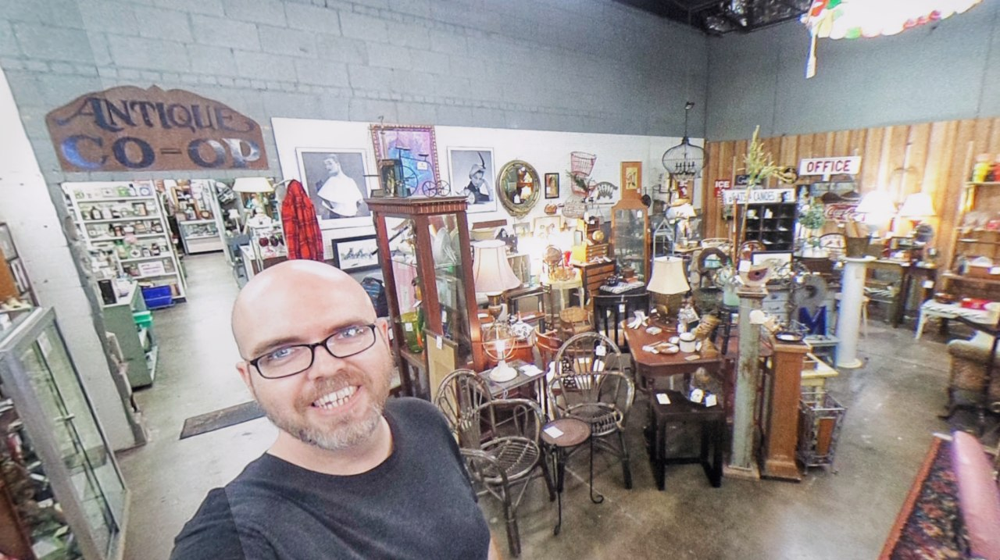
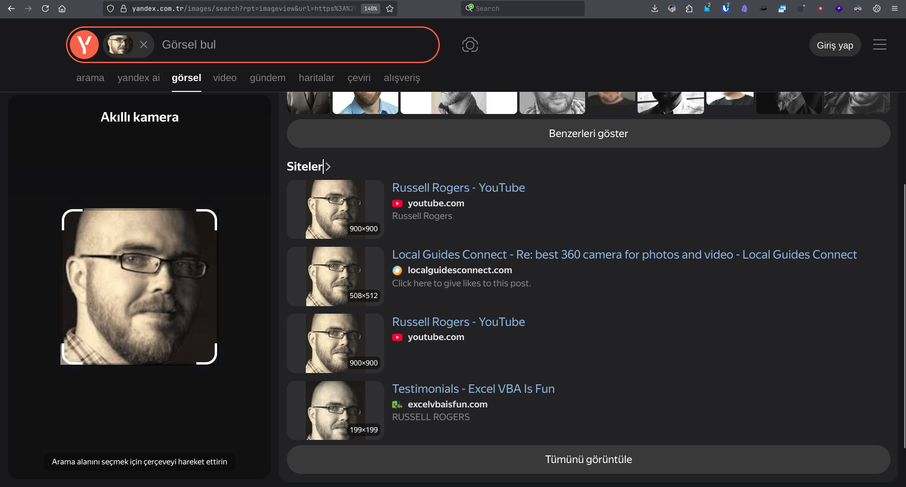

# Junior Crypt 2026 CTF - `WhoAmI` Writeup

- **Yazar:** Efe Şahinbaş
- **GitHub Deposu:** [MacallanTheRoot/ctf-writeups](https://github.com/MacallanTheRoot/ctf-writeups/)
- **Kategori:** OSINT
- **Hedef:** `WhoAmI.jpg`
- **Flag formatı:** `grodno{FirstName_LastName}`

## Soru Açıklaması

```text
While traveling through Oklahoma, I stumbled upon an interesting shop and took
this selfie. Can you figure out my name?

Flag format: grodno{FirstName_LastName}
```

## Özet

Challenge fotoğrafındaki mağaza ayrıntılarıyla yapılan standart tersine görsel aramalar anlamlı bir kişi eşleşmesi vermedi. Bunun üzerine yüz odaklı arama kullanıldı. PimEyes aynı kişiye benzeyen iki sonuç gösterdi; sonuçlardan birindeki portre ayrı olarak tersine aratıldığında `Russell Rogers` adına bağlı YouTube ve profil sonuçları bulundu.

## 1. Challenge Görseli

Verilen fotoğraf Oklahoma'daki bir antika mağazasında çekilmiş bir selfie idi. Arka plandaki `Antique Co-Op` yazısı mekân hakkında bağlam sağlasa da soru doğrudan kişinin adını istiyordu.



İlk tersine görsel aramalar çoğunlukla fotoğraftaki antika mobilyalara ve mağaza içi nesnelere odaklandı. Bu nedenle bu sonuçlar kişiyi tanımlamak için yeterli olmadı.

## 2. Yüz Eşleşmesi

Fotoğraftaki yüz PimEyes üzerinde aratıldı. Sonuçlarda aynı kişiye ait görünen iki portre elde edildi.


Arama sonucundaki kaynak bağlantıları üyelik gerektirdiği için ilk portre kırpılarak ayrı bir tersine görsel aramada kullanıldı.

## 3. İsmin Doğrulanması

İkinci arama, aynı portreyi `Russell Rogers` adıyla ilişkilendiren birden fazla sonuç gösterdi. Görünen sonuçlar arasında aynı adla YouTube girdileri ve başka profil sayfaları bulunuyordu.



Birden fazla sonucun aynı yüzü ve aynı adı göstermesiyle kimlik doğrulandı. Challenge formatına göre ad ve soyad alt çizgiyle birleştirildi.

## Flag

```text
grodno{Russell_Rogers}
```

## Çözüm Zinciri

```text
Challenge selfie görseli
  -> standart tersine arama sonuçsuz
  -> PimEyes ile yüz eşleşmesi
  -> eşleşen portreyi tersine arama
  -> Russell Rogers
```
