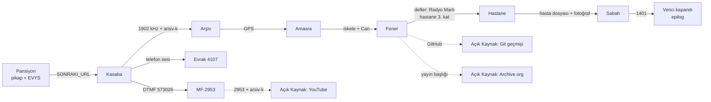

# Kayıp Frekans OSINT CTF — 19/20 Çözüm Yazısı

> **Spoiler:** Bu çözüm, tamamlanmış 15 Eylül 2026 yarışmasının 19 flag'ini içerir. 19/20, yazarın kendi çözüm kaydıdır; resmî sıralama iddiası değildir.
>
> **Kanıt görselleri:** Orijinal çalışma arşivindeki 10 ekran görüntüsü / görsel bu GitHub metin sürümünde yeniden dağıtılmamıştır. Görsellere ait açıklamalar metinde korunmuştur. Oyun materyallerinin hakları ilgili yapımcılara aittir.
>
> **Yeniden üretilebilirlik:** Aşağıdaki bazı komutlar, yazarın yarışma sırasında oluşturduğu `workspace/linear-story/kayipfrekans-20260915-143018/` klasörünü referans alır. Bu yerel arşiv ve orijinal challenge dosyaları depoda yer almaz.

- **Etkinlik:** Kayıp Frekans OSINT CTF
- **Yazar:** Hamza Efe Şahinbaş
- **Tarih:** 15 Eylül 2026
- **Sonuç:** **19/20**
- **Eksik:** Fener bölümünün üçüncü normal flag'i

> Bu yazı yarışma sırasında kaydettiğim sayfa kaynakları, ağ yanıtları, indirilen dosyalar, tarayıcı konsolu, Git geçmişi ve terminal kayıtları yeniden kontrol edilerek hazırlandı. Resmî forma otomatik istek gönderilmedi; 19 cevap yarışma sonunda insan eliyle gönderildi ve geçerli olduğu görüldü.

## TL;DR / Özet

Kayıp Frekans, tek bir pansiyon sayfasından başlayıp Kasaba, Arşiv, Fener, Hastane ve Sabah bölümlerine uzanan doğrusal bir OSINT hikâyesiydi. Normal hikâye akışında 17 olası puanın 16'sını; açık kaynak görevlerinde ise 3/3 yaptım. Toplam sonuç **19/20** oldu.

| Bölüm | Sonuç |
|---|---:|
| Pansiyon | 2/2 |
| Kasaba | 3/3 |
| Arşiv | 3/3 |
| Fener | 2/3 |
| Hastane | 3/3 |
| Sabah | 3/3 |
| Açık Kaynak | 3/3 |
| **Toplam** | **19/20** |

Çözüm zincirinin omurgası; HTML/DOM incelemesi, tarayıcı konsolu ve ağ yanıtları, ses analizi, spektrogram, EXIF/GPS, barkod, ZIP metadata'sı, RGB-LSB, Git geçmişi ve herkese açık YouTube/Archive.org kayıtlarından oluştu. En önemli sınıflandırma düzeltmesi şuydu: Git geçmişinden çıkan `NGNCLOUD{gecmis_silinmez}` Fener'in eksik üçüncü flag'i değil, **Açık Kaynak / GitHub** cevabıydı.

## Challenge yapısı

Ana hikâyede her sayfa hem kendi flag'lerini hem de bir sonraki düğüme giden ipucunu taşıyordu. Bu nedenle bir flag bulduğumda sayfayı kapatmadım; kalan etkileşimleri, indirilen dosyaları, DOM'u ve ağ yanıtlarını da kontrol ettim.

İnceleme boyunca aşağıdaki olay klasörünü esas aldım:

```text
workspace/linear-story/kayipfrekans-20260915-143018/
```

Komutlarda uzun yolu tekrar etmemek için şu değişken kullanılabilir:

```bash
CASE=workspace/linear-story/kayipfrekans-20260915-143018
```

Kanıt sıralamasında indirilen orijinal dosyaları ve yakalanmış ağ yanıtlarını öne aldım. `journey.md` ve `answer-key.json`, ancak bunlarla çelişmedikleri sürece yön bulma ve zaman çizelgesi için kullanıldı.

## Araçlar

- Chromium ve `playwright-cli`: normal sayfa etkileşimi, DOM, konsol ve ağ yanıtları
- `rg`, `sed`, `perl`, `xxd`: kaynak, yorum, metin ve kodlama analizi
- `ffmpeg`, `ffprobe`: ses dönüştürme, kanal ve spektrogram analizi
- Open-SSTV: Martin M1 görüntüsünün çözülmesi
- `exiftool`: EXIF, GPS ve ID3 alanları
- `zxing-cpp`: Code 128 barkod okuma
- `unzip`: ZIP yorumunu görme ve parola ile çıkarma
- `zsteg`: PNG RGB-LSB kontrolü
- `git log`, `git show`: silinmiş Git içeriğini geri çağırma
- `yt-dlp`, `jq`: YouTube metadata'sı ve altyazı indirme
- Archive.org metadata API'si: herkese açık kaset kaydını doğrulama

## Bölüm I — Pansiyon

### Pikaptaki plaka

Başlangıç sayfasındaki `assets/pikap.png` görselini yalnızca tarayıcı boyutunda değerlendirmek yerine indirilmiş orijinal kopyası `start-pikap.png` üzerinden açtım:

```bash
file "$CASE/downloads/start-pikap.png"
sha256sum "$CASE/downloads/start-pikap.png"
```

```text
PNG image data
c72f85ed6a94f79f7d85688d86e7e3c78ffe5f4d6e278876accb9beda58fb0fb
```

*Kanıt görseli (orijinal arşiv): Pansiyondaki pikap ve plaka.*

Plakanın altındaki soluk yazı, büyütülmüş orijinalde doğrudan okunuyordu:

```text
NGNCLOUD{plaktaki_kadin}
```

Bu, görsel yorumuna dayalı bir tahmin değildi; metin dosyanın piksellerinde açıkça bulunuyordu. İlk flag:

**Flag:** `NGNCLOUD{plaktaki_kadin}`

Pikap incelemesinden sonra resepsiyondaki yerel **EVYS** terminaline geçtim.

### EVYS parolası ve bakım konsolu

Kaynak kodda parola karşılaştırmasının normalleştirilmiş girdiye uygulanan SHA-256 ile yapıldığını gördüm:

```bash
rg -n -C 5 'SIFRE_H|KFSIFRE|cozSunucu|BAKIM NOTU' \
  "$CASE/pages/start/index.html"
```

İlgili mantık şuydu:

```text
SIFRE_H = 1213be75f46d31205cfefa245f3e95f1aa8f4b67640f16ac25ce391f8537dda5
SHA-256("KFSIFRE::" + normalize(girdi))
```

Sayfadaki başarısız/başarılı giriş diyaloğu “Dünyanın en iyisi. Bir iki üç.” ifadesini veriyordu. Türkçe karakterleri kaldırıp boşlukları silince parola `dunyanineniyisi123` oldu. Kaynakta kayıtlı hash ile ilişkiyi doğruladım:

```bash
python3 - <<'PY'
import hashlib
s = 'dunyanineniyisi123'
h = hashlib.sha256(('KFSIFRE::' + s).encode()).hexdigest()
print(s, h)
print(h == '1213be75f46d31205cfefa245f3e95f1aa8f4b67640f16ac25ce391f8537dda5')
PY
```

```text
dunyanineniyisi123 1213be75f46d31205cfefa245f3e95f1aa8f4b67640f16ac25ce391f8537dda5
True
```

Parolayı yerel forma girdim:

```bash
playwright-cli -s=kf fill '#parola' 'dunyanineniyisi123'
playwright-cli -s=kf console
```

Konsoldaki bakım notu exact flag biçimini verdi:

```text
[BAKIM NOTU] kullanıcının parolası hâlâ eski biçimde: NGNCLOUD{dunyanin_en_iyisi_123}
```

Aynı metin yarışma sırasında kaydedilen ağ yanıtında da bulunuyordu:

```bash
playwright-cli -s=kf response-body 18
```

```json
{"ok":true,"t":"[BAKIM NOTU] kullanıcının parolası hâlâ eski biçimde: NGNCLOUD{dunyanin_en_iyisi_123}"}
```

Burada giriş parolası ile flag'in yazımı farklıydı. Cevap olarak konsolun verdiği alt çizgili exact string'i kullandım.

**Flag:** `NGNCLOUD{dunyanin_en_iyisi_123}`

EVYS girişi, oda notları ve kaynakta bulunan `SONRAKI_URL` beni Kasaba sayfasına götürdü.

## Bölüm II — Kasaba

### Radyo, telefon ve `573026`

Kasaba radyosunda aynı altı DTMF tonu tekrar ediyordu. Yarışma sırasında sesi 8 kHz mono ham örneklere çevirip her 100 ms pencere için DTMF satır/sütun frekanslarının FFT tepe değerlerini eşledim. Çözüm oturumundaki tespit kodunun ilgili kısmı:

```bash
uv run --with numpy python3 - <<'PY'
import subprocess, numpy as np
p='workspace/linear-story/kayipfrekans-20260915-143018/downloads/kasaba-radyo.m4a'
x=np.frombuffer(subprocess.check_output([
    'ffmpeg','-v','error','-i',p,'-ac','1','-ar','8000','-f','f32le','pipe:1'
]), np.float32)
sr=8000; n=800
pair={(697,1209):'1',(697,1336):'2',(697,1477):'3',
      (770,1209):'4',(770,1336):'5',(770,1477):'6',
      (852,1209):'7',(852,1336):'8',(852,1477):'9',(941,1336):'0'}
last=None; runs=[]
for k in range(len(x)//n):
    z=x[k*n:(k+1)*n]*np.hanning(n)
    sp=np.abs(np.fft.rfft(z)); fr=np.fft.rfftfreq(n,1/sr); base=np.median(sp[20:])
    e={f:sp[np.argmin(abs(fr-f))]/base for f in {q for p in pair for q in p}}
    hit=max(pair,key=lambda p:min(e[p[0]],e[p[1]]))
    d=pair[hit] if min(e[hit[0]],e[hit[1]])>100 else None
    if d!=last:
        if last: runs[-1][2]=k*.1
        if d: runs.append([d,k*.1,None])
        last=d
if last: runs[-1][2]=(len(x)//n)*.1
print(' '.join(f'{d}@{a:.1f}-{b:.1f}' for d,a,b in runs))
PY
```

İlgili çıktı:

```text
5 @ 0.5–0.7 s
7 @ 0.7–0.9 s
3 @ 1.0–1.2 s
0 @ 1.2–1.4 s
2 @ 1.4–1.6 s
6 @ 1.7–1.9 s
```

Dizi parça boyunca tekrar ettiği için telefon numarası `573026` idi. Sayfadaki telefona bunu girince yanıt gövdesinde Base64 veri döndü:

```bash
playwright-cli -s=kf request-body 45
playwright-cli -s=kf response-body 45
```

```text
YmVsbGVrIGTDtmvDvG3DvCAwNCDigJQgRVZZUyB5ZXJlbCBhcsWfaXY6IG1pa3JvZmnFnyByZWYgTUYtMjk1Mw==
```

```bash
python3 - <<'PY'
import base64
s='YmVsbGVrIGTDtmvDvG3DvCAwNCDigJQgRVZZUyB5ZXJlbCBhcsWfaXY6IG1pa3JvZmnFnyByZWYgTUYtMjk1Mw=='
print(base64.b64decode(s).decode())
PY
```

```text
bellek dökümü 04 — EVYS yerel arşiv: mikrofiş ref MF-2953
```

Bu aşamadaki ana pivot **MF-2953** oldu.

### İstasyon kaydını görmek

Geniş bant radyoda konuşma açıkça `1902 kHz` diyordu ve “cızırtının içinde bir şey daha var, kulak yetmiyor” uyarısını veriyordu. Bunun üzerine istasyon sesini spektrograma çevirdim:

```bash
ffmpeg -hide_banner -loglevel error -y -ss 10.5 \
  -i "$CASE/downloads/kasaba-istasyon.m4a" \
  -lavfi 'showspectrumpic=s=3600x1200:legend=0:color=fiery:scale=lin:fscale=lin:gain=8' \
  "$CASE/evidence/kasaba/istasyon-hidden-spectrum-linear.png"
```

*Kanıt görseli (orijinal arşiv): İstasyon kaydının spektrogramı.*

Spektrogramda flag harfleri doğrudan görünüyordu:

**Flag:** `NGNCLOUD{gozle_dinle}`

Buradaki `1902`, sonraki düğümlerde tekrar eden **verici frekansıydı**. Hastane ZIP parolasında aynı dört rakam farklı bir gerekçeyle, `19.02` doğum tarihinden üretilecekti.

### Mikrofiş `MF-2953`

Telefondan çıkan referansı EVYS mikrofiş alanına girdim ve kaydedilmiş ağ yanıtını kontrol ettim:

```bash
playwright-cli -s=kf request-body 46
playwright-cli -s=kf response-body 46
```

```json
{"id":"fa","a":"2953"}
{"ok":true,"t":"MİKROFİŞ MF-2953 — ...\nDoğrulama işareti: NGNCLOUD{kasaba_unutmaz}"}
```

**Flag:** `NGNCLOUD{kasaba_unutmaz}`

`2953` daha sonra Arşiv'deki klip numarası ile YouTube'daki video başlığını da birbirine bağladı.

### Evrak `4107`

Telefon etkileşiminden indirilen diğer ses kaydında şu cümle vardı:

```text
Kayıt, evrak, dört, bir, sıfır, yedi; tekrar dört, bir, sıfır, yedi.
```

Yarışma sırasında kullandığım konuşma dökümü komutu şuydu:

```bash
uv run --with faster-whisper python - <<'PY'
from faster_whisper import WhisperModel
p='workspace/linear-story/kayipfrekans-20260915-143018/downloads/kasaba-telefon.m4a'
m=WhisperModel('base',device='cpu',compute_type='int8')
segs,info=m.transcribe(p,language='tr',beam_size=5,
    condition_on_previous_text=False,vad_filter=False,word_timestamps=True)
for s in segs:
    print(f'{s.start:.2f}-{s.end:.2f}: {s.text}')
    print([(w.word,round(w.probability,3)) for w in (s.words or [])])
PY
```

Rakamların kelime olasılığı yaklaşık 0.85–0.997 aralığındaydı. EVYS Evrak alanına `4107` yazınca:

```bash
playwright-cli -s=kf request-body 47
playwright-cli -s=kf response-body 47
```

```json
{"id":"fb","a":"4107"}
{"ok":true,"t":"SANTRAL OTOMASYON KAYDI — HAT 6\n...\nBütünlük doğrulaması: NGNCLOUD{makine_makineyle_konusur}"}
```

**Flag:** `NGNCLOUD{makine_makineyle_konusur}`

Pano notundaki `arsiv-k` adı ve açılan bağlantı sonraki durak olan Arşiv'e götürdü.

## Bölüm III — Arşiv

### `sahil-foto.jpg`: EXIF ve Amasra

Arşivdeki sahil fotoğrafının metadata'sını sayfada görünen açıklamadan bağımsız olarak kontrol ettim:

```bash
exiftool -n -GPSLatitude -GPSLongitude -UserComment \
  "$CASE/downloads/arsiv-sahil-foto.jpg"
```

```text
GPS Latitude  : 41.74944
GPS Longitude : 32.38639
User Comment  : NGNCLOUD{her_foto_iz_birakir}
```

**Flag:** `NGNCLOUD{her_foto_iz_birakir}`

Dosyada hem flag hem sonraki pivot vardı. Koordinatların DMS biçimi `41°44'57.98"N, 32°23'11.00"E` idi. Pasif OpenStreetMap/Nominatim reverse-geocode sonucu konumu **Amasra, Bartın** olarak doğruladı. Sayfanın konum alanına `Amasra` yazınca yakalanan yanıt da bunu onayladı:

```json
{"id":"konum","a":"amasra"}
{"ok":true,"t":"Amasra. Fotoğraf orada çekilmiş."}
```

### `klip-2953.png`: sansür katmanı ve orijinal dosya

`klip-2953.png` ekranda siyah bir bantla sansürlü görünüyordu. DOM'u kontrol ettiğimde bandın görüntünün parçası olmadığını, görselin üzerine ayrı bir `div.siyahBant` eklendiğini gördüm:

```bash
rg -n -C 4 'siyahBant|klip-2953' "$CASE/pages/arsiv/index.html"
```

```html

<div class="siyahBant"></div>
```

Tarayıcı görünümü ile indirilen orijinal dosya arasındaki fark netti:

| Sayfanın gösterdiği | Orijinal asset |
|---|---|
| *Kanıt görseli (orijinal arşiv): Klip üzerindeki DOM sansürü.* | *Kanıt görseli (orijinal arşiv): Klip dosyasının orijinali.* |

Orijinal dosyanın alt kısmında “ARŞİV DOĞRULAMA KODU” ile birlikte flag açıkça yazıyordu.

**Flag:** `NGNCLOUD{silinen_geri_doner}`

Bu adım klasik bir “görseli iyileştirerek sansürü kaldırma” işlemi değildi. Veri hiç silinmemişti; yalnızca DOM katmanıyla örtülmüştü.

### Seri ilanların ilk harfleri ve hex

Arşivdeki seri ilanların her satırının ilk karakterini sırayla aldığımda hexadecimal bir dize oluştu:

```bash
perl -Mutf8 -CSD -ne 'while(/<li>(.)/g){print $1}' \
  "$CASE/pages/arsiv/index.html"
```

```text
4E474E434C4F55447B7365737D
```

Hex'i ham metne çevirdim:

```bash
printf '%s' '4E474E434C4F55447B7365737D' | xxd -r -p
```

```text
NGNCLOUD{ses}
```

**Flag:** `NGNCLOUD{ses}`

GPS'in verdiği Amasra yanıtı “İskele oradaydı. Gitmeliyim.” sahnesini açtı. İskelede Can ile konuşma başladı; hasta olduğunu söyleyen Can'ın “Hissetmeye çalışılmaz ki. Sadece durursun.” cümlesi ileride Sabah bölümünde Nisa tarafından aynen geri çağrıldı. Diyaloğun sonunda kaynak `CONFIG.SONRAKI_URL` bağlantısını görünür yaptı ve Fener'e geçtim.

## Bölüm IV — Fener

Fener, yarışmada tek eksik bıraktığım bölümdü. İki normal flag doğrudan kanıtlandı; üçüncü normal flag bulunamadı. Bu bölümde görülen GitHub flag'i daha sonra açık kaynak kategorisinde geçerli sayıldığı için Fener'e eklenmedi.

### Defter ve verici odası

Fenerdeki defter dört önemli pivot veriyordu:

```text
github.com/arsiv-k/fener-verici
yayın 03:12 · 1902 kHz · her gece
kaset □ Radyo Martı, hastane 3. kat
```

*Kanıt görseli (orijinal arşiv): Fener defteri.*

Buradaki `1902 kHz`, Kasaba'da duyduğum frekansı doğruladı. `03:12` yayın saatini, `Radyo Martı` ile `hastane 3. kat` ise hem hikâye pivotunu hem daha sonra Archive.org aramasını besledi. GitHub deposunu bu noktada keşfettim; fakat oradan çıkan cevabın doğru kategorisi **Açık Kaynak** idi.

### `yayin.wav`: SSTV Martin M1

Verici odasından indirilen `assets/yayin.wav` dosyası 115.2 saniyelik, 11025 Hz mono PCM sesti. Open-SSTV ile çözdüm:

```bash
uvx --from 'git+https://github.com/bucknova/Open-SSTV.git' \
  open-sstv-decode "$CASE/downloads/fener-yayin.wav" \
  -o "$CASE/evidence/fener/yayin-sstv.png"
```

İlgili decoder çıktısı:

```text
VIS 0x2c
Martin M1
320x256
```

*Kanıt görseli (orijinal arşiv): Martin M1 ile çözülen SSTV karesi.*

Çözülen karede flag doğrudan görünüyordu.

**Flag:** `NGNCLOUD{sesin_resmi}`

### `teyp.m4a`: Morse ve panel kodu `7418`

Teyp kaydını dinlediğimde aynı dört Morse grubu üç kez tekrarlanıyordu:

```text
--... / ....- / .---- / ---..
```

Görsel kontrol için yarışma sırasında spektrogram da oluşturdum:

```bash
ffmpeg -hide_banner -loglevel error -y \
  -i "$CASE/downloads/fener-teyp.m4a" \
  -lavfi 'showspectrumpic=s=3600x1200:legend=1:color=fiery:scale=lin:fscale=lin:gain=8' \
  "$CASE/evidence/fener/teyp-spectrum.png"
```

Standart Morse rakam eşlemesi:

```text
--... = 7
....- = 4
.---- = 1
---.. = 8
```

Dolayısıyla panel kodu `7418` idi. Sayfada dekoratif olarak görünen başka dört haneli sayıları kullanmadım; doğru kod, ses artefaktından çıkan ve sunucu yanıtıyla doğrulanan `7418` oldu:

```bash
playwright-cli -s=kf request-body 98
playwright-cli -s=kf response-body 98
```

```json
{"id":"p4","a":"7418"}
{"ok":true,"t":"KİLİT AÇILDI\nVERİCİ KAYDI 04 · FENER\nsinyal kaynağı: bu oda\nçağrı işareti: yayın başlığında\n\nNGNCLOUD{isik_sondu_sinyal_kaldi}"}
```

**Flag:** `NGNCLOUD{isik_sondu_sinyal_kaldi}`

Bu yanıt ayrıca açık kaynak araştırmasında önemli olacak `çağrı işareti: yayın başlığında` ipucunu verdi. Fener anlatısındaki mikrofon, Nisa ve hastanenin üçüncü katı referansları ise ana hikâyeyi Hastane'ye taşıdı.

### Bulunamayan üçüncü Fener flag'i

Fener sonucu **2/3** kaldı. Eksik cevabı uydurmamak için yalnızca doğrulanmış iki flag'i yazdım. En güçlü fakat sonuç vermeyen kontroller şunlardı:

- `fener.mp3` için sol/sağ, orta/yan kanal, ters çevirme, yüksek frekans ve spektrogram kontrolleri yaptım. Kayıt normal “Rue des Couleurs” müziğiydi. `03:12` civarındaki “If I disappear, let my colors stay here” cümlesinden türetilen `let_my_colors_stay_here` yükü resmî kontrolde kabul edilmedi.
- `teyp.m4a` ve MP3 sürümünde aynı Morse mesajından başka güvenilir bir ikinci veri çıkmadı.
- Duvar fotoğrafı, CRT ve `nisa-mikrofon` görselinde `exiftool`, `binwalk`, `zsteg`, boş parolalı `steghide` ve kanal/geometrik hizalama kontrolleri yaptım. C2PA/SynthID üretim bilgisi dışında challenge cevabı sayılabilecek tekrarlanabilir bir payload bulamadım.
- Paneldeki dekoratif `4783`/`6832` benzeri sayılar ses kaydından çıkmıyor ve doğru sunucu yanıtı üretmiyordu. Kanıtlı panel kodu `7418` idi.

Bu yüzden Git geçmişindeki geçerli açık kaynak cevabını Fener'in eksik normal cevabı gibi göstermedim.

## Bölüm V — Hastane

### Hasta bilekliği: Code 128

Hastane odasındaki `bileklik.png` dosyasını barkod okuyucuya verdim:

```bash
uv run --with zxing-cpp --with pillow python - <<'PY'
from PIL import Image
import zxingcpp
p='workspace/linear-story/kayipfrekans-20260915-143018/downloads/hastane/bileklik.png'
b=zxingcpp.read_barcodes(Image.open(p))[0]
print('text=',b.text)
print('format=',b.format)
print('valid=',b.valid)
PY
```

```text
text= NGNCLOUD{bilekteki_kimlik}
format= BarcodeFormat.Code128
valid= True
```

*Kanıt görseli (orijinal arşiv): Hasta bilekliğindeki Code 128.*

**Flag:** `NGNCLOUD{bilekteki_kimlik}`

### ZIP yorumu, kolye ve `1902`

Hastane terminalindeki bağlantıdan `hasta-dosyasi.zip` dosyasını indirdim; aynı terminal, `type OKUBENI.TXT` çıktısını sayfanın içinde gösteriyordu. Arşiv listesinin başındaki ZIP yorumu parola kuralını veriyordu:

```bash
unzip -l "$CASE/downloads/hastane/arsiv-hasta-dosyasi.zip"
```

```text
Archive:  arsiv-hasta-dosyasi.zip
kilit: dört rakam. onun günü.
  Length  Name
     891  epikriz.txt
     251  hemsire-notu.txt
```

Kolyeyi ters çevirdiğimde `19.02` tarihi okunuyordu:

*Kanıt görseli (orijinal arşiv): Ters çevrilmiş kolyede 19.02.*

Noktayı kaldırınca dört haneli parola `1902` oldu:

```bash
unzip -P 1902 -o "$CASE/downloads/hastane/arsiv-hasta-dosyasi.zip" \
  -d "$CASE/evidence/hastane/zip-1902"
```

```text
extracting: epikriz.txt
extracting: hemsire-notu.txt
```

`epikriz.txt` içindeki ilgili satır:

```text
Kayıt mührü: NGNCLOUD{parola_dogum_gunu}
```

**Flag:** `NGNCLOUD{parola_dogum_gunu}`

Buradaki parola, `1902 kHz` frekansından değil, kolyedeki **19.02 doğum gününden** çıkarıldı. Aynı rakamların hikâyede iki farklı bağlamda kullanılması özellikle yanıltıcıydı.

Epikriz ve hemşire notu ayrıca Radyo Martı, `91.7`, üçüncü kat ve “3. kat için” ifadelerini tekrar ederek hem Sabah'a hem açık kaynak kaset kaydına bağ kurdu.

### `hastane-fotograf.png`: RGB-LSB

`OKUBENI.TXT`, fotoğraf kopyasının “tarayıcıdan bit bit aktarıldığını” söylüyordu. Bu ifade doğrudan bit düzlemlerini işaret ettiği için PNG'yi `zsteg` ile kontrol ettim:

```bash
zsteg "$CASE/downloads/hastane/hastane-fotograf.png" \
  | rg 'b1,rgb,lsb,xy|NGNCLOUD'
```

```text
b1,rgb,lsb,xy .. text: "NGNCLOUD{piksellerin_altinda}\n"
```

Metin RGB kanallarının en düşük anlamlı bitlerinde ve tarama sırasına göre tekrar ediyordu.

**Flag:** `NGNCLOUD{piksellerin_altinda}`

Fotoğraf, ters çevrilmiş kolye ve hasta dosyası tamamlandığında Radyo Martı/üçüncü kat anlatısı Sabah bölümünü açtı.

## Bölüm VI — Sabah

### Mühür görseli

Sabah sayfasının kaynağında epilog sırasında görünür hâle getirilen `muhur.png` dosyasını orijinal boyutta açtım:

```bash
sha256sum "$CASE/downloads/sabah/muhur.png"
```

```text
3cbbe144fedc91549ffb0802afa783296bd633d751e0c2803216dbbdf55c937e
```

*Kanıt görseli (orijinal arşiv): Sabah bölümündeki kayıt mührü.*

Mührün içinde flag doğrudan okunuyordu:

**Flag:** `NGNCLOUD{frekans_bulundu}`

Yarışma çözüm sıramda dosyayı kaynakta erken fark ettim; fakat hikâye akışında görsel, verici kapatıldıktan sonra açılan epilogun parçasıydı. Bu nedenle Sabah bölümüne aittir.

### Nisa'nın cümlesi ve kapatma kodu `1401`

Nisa'nın diyalogdaki cümlesi kesin kod kaynağıydı:

```text
Kapatma kodunu sen koydun. Tanıştığımız gün. On dört, sıfır bir.
```

Bu yüzden dekoratif panel rakamlarına değil, anlatının açıkça söylediği `1401` koduna güvendim:

```bash
playwright-cli -s=kf fill '#kodGiris' '1401'
playwright-cli -s=kf click '#kodBtn'
playwright-cli -s=kf request-body 154
playwright-cli -s=kf response-body 154
```

```json
{"id":"k6","a":"1401"}
{"ok":true,"t":"KAPATMA KODU KABUL EDİLDİ\nVERİCİ · 1902 kHz · DURDURULDU\nson yayın: bu sabah\n\nNGNCLOUD{artik_dinlemiyorum_yasiyorum}"}
```

**Flag:** `NGNCLOUD{artik_dinlemiyorum_yasiyorum}`

Burada `1902 kHz` vericinin durdurulduğu frekans olarak son kez doğrulandı. Fener panelindeki `7418` kilit kodu ile Sabah verici kapatma kodu `1401` birbirinden tamamen ayrıydı.

### Kapatma sonrası EVYS konsolu

Vericiyi kapattıktan sonra sayfa `c6` bakım isteğini çalıştırdı. Ağ yanıtını ve konsolu kontrol ettim:

```bash
playwright-cli -s=kf request-body 155
playwright-cli -s=kf response-body 155
playwright-cli -s=kf console
```

```text
[BAKIM NOTU] kullanıcı parolasını değiştirdi. yeni parola: NGNCLOUD{sadece_bir_insan}
```

**Flag:** `NGNCLOUD{sadece_bir_insan}`

Epilog, vericinin sustuğunu ve karakterin artık yayını dinlemek yerine kendi hayatına döndüğünü anlatıyordu. Böylece pansiyondaki eski parolayla başlayan EVYS motifi, Sabah'taki yeni parola ile kapandı.

## Açık Kaynak

Açık kaynak bölümü üç ayrı platformdan oluşuyordu. Aynı anlatı anahtarlarını paylaşsalar da GitHub, YouTube ve Archive.org kanıtlarını birbirine karıştırmadan ayrı değerlendirdim.

### GitHub — silinen `config.json`

Fener defterindeki bağlantı herkese açık [`arsiv-k/fener-verici`](https://github.com/arsiv-k/fener-verici) deposuna gidiyordu. Yarışma sırasında deponun mirror kopyasını `evidence/fener-github/fener-verici.git` altında sakladım. Geçmiş:

```bash
REPO="$CASE/evidence/fener-github/fener-verici.git"
git --git-dir="$REPO" log --all --date=iso \
  --pretty=format:'%h %ad %s' --name-status
```

```text
bb7441e 2024-01-14 01:05:00 +0300 README: çalıştırma notu
M README.md
a118a94 2021-11-03 22:41:00 +0300 config.json kaldırıldı, örnek dosya eklendi
M README.md
A config.example.json
D config.json
1d81a52 2019-02-19 03:12:00 +0300 ilk sürüm: yayın zamanlayıcısı + yapılandırma
A README.md
A config.json
A yayin.py
```

Silinmeden önceki dosyayı ilk commit'ten çağırdım:

```bash
git --git-dir="$REPO" show \
  1d81a5261d36f8db688304098904ebc492121d06:config.json
```

```json
{
  "frekans_khz": 1902,
  "saat": 3,
  "dakika": 12,
  "kayit": "kayit-2953.wav",
  "dogrulama": "NGNCLOUD{gecmis_silinmez}",
  "not": "bu dosyayı paylaşma"
}
```

**Flag:** `NGNCLOUD{gecmis_silinmez}`

Bu cevap Fener sırasında bulunduğu için önce yanlış bölümde kontrol edildi ve ara kayıtlarda “decoy” olarak işaretlendi. Daha sonraki insan doğrulaması bunun geçerli olduğunu, ancak **Açık Kaynak / GitHub** bölümüne ait olduğunu kesinleştirdi. Dolayısıyla Fener'in üçüncü normal flag'i değildir.

### YouTube — `arsiv-k / kayıt 2953`

Kasaba'daki `MF-2953` ve `arsiv-k` adları beni `arsiv-k` kanalındaki [`kayıt 2953`](https://www.youtube.com/watch?v=iXvwDru0Vv4) videosuna götürdü. Yarışma sırasında video ID'si `iXvwDru0Vv4` olan kaydın metadata'sını ve sunulan Türkçe altyazısını indirdim:

```bash
yt-dlp --skip-download --write-info-json --write-description \
  --write-subs --write-auto-subs --sub-langs 'all,-live_chat' \
  --no-playlist \
  -o "$CASE/evidence/youtube-arsiv-k/%(id)s.%(ext)s" \
  'https://www.youtube.com/watch?v=iXvwDru0Vv4'
```

```bash
jq -r '.id,.title,.channel,.description' \
  "$CASE/evidence/youtube-arsiv-k/iXvwDru0Vv4.info.json"
```

```text
iXvwDru0Vv4
kayıt 2953
arsiv-k
gece yine başladı. kaydettim. sayıları yazıya döktüm. kim dinliyorsa artık.
```

Kesin cevap metadata içinde gizli bir alan değildi. Türkçe VTT altyazısında doğrudan yer alıyordu:

```bash
sed -n '1,120p' \
  "$CASE/evidence/youtube-arsiv-k/iXvwDru0Vv4.tr.vtt"
```

```text
00:00:05.200 --> 00:00:09.400
bir dokuz sıfır iki

00:00:33.600 --> 00:00:36.799
NGNCLOUD{kim_dinliyorsa_artik}
```

Başlık ve açıklama doğru kaydı seçmemi sağladı; cevap ise videonun yayımlanmış altyazı metninden exact string olarak geldi. Ek bir metin dönüşümü uygulamadım.

**Flag:** `NGNCLOUD{kim_dinliyorsa_artik}`

### Archive.org — Radyo Martı kaseti

Fener paneli `çağrı işareti: yayın başlığında` diyordu. Defter ve hastane dosyaları da `Radyo Martı`, `91.7`, `3. kat` ve `arsiv-k` anahtarlarını tekrar ediyordu. Bunlarla Archive.org'un herkese açık aramasında başlığı sorguladım:

```bash
curl -fsSLG 'https://archive.org/advancedsearch.php' \
  --data-urlencode 'q="Radyo Martı"' \
  --data-urlencode 'fl[]=identifier,title,creator,description,subject,mediatype,date,publicdate' \
  --data-urlencode 'rows=50' \
  --data-urlencode 'output=json'
```

Sonuçtaki identifier [`radyo-marti-91-7-kaset`](https://archive.org/details/radyo-marti-91-7-kaset) idi. Kayıt başlığı `Radyo Martı 91.7 · gece kuşağı · kaset kaydı`, creator alanı ise `arsiv-k` olarak dönüyordu.

*Kanıt görseli (orijinal arşiv): Archive.org Radyo Martı kaset kapağı.*

Öğe metadata'sını ve original MP3'ü kaydettim:

```bash
curl -fsSL 'https://archive.org/metadata/radyo-marti-91-7-kaset' \
  -o "$CASE/evidence/archive-org/radyo-marti-91-7-kaset-metadata.json"
```

İndirilen original dosyanın MD5'i Archive.org metadata'sındaki `baf8e77636c2ba1da17d092126373fea` değeriyle eşleşti. Exact flag, MP3'ün **ID3v2.3 Comment** alanındaydı:

```bash
exiftool -G1 -a -s \
  "$CASE/evidence/archive-org/radyo-marti-91-7-kayit.mp3" \
  | rg 'Title|Artist|Album|Comment'
```

```text
[ID3v2_3] Title   : Radyo Martı 91.7 · gece kuşağı (kaset kaydı)
[ID3v2_3] Artist  : arsiv-k
[ID3v2_3] Album   : kasetler
[ID3v2_3] Comment : NGNCLOUD{ucuncu_kat_icin}
```

**Flag:** `NGNCLOUD{ucuncu_kat_icin}`

Bu üç açık kaynak cevabında platformların görevleri farklıydı: GitHub'da silinmiş geçmiş, YouTube'da yayımlanmış altyazı, Archive.org'da ise original MP3 metadata'sı.

## Final Flag Tablosu

| Bölüm | Flag | Teknik | Artefakt / kaynak |
|---|---|---|---|
| Pansiyon | `NGNCLOUD{plaktaki_kadin}` | Görsel inceleme | `start-pikap.png` |
| Pansiyon | `NGNCLOUD{dunyanin_en_iyisi_123}` | SHA-256 ilişkilendirme, konsol/ağ yanıtı | EVYS, `pages/start/index.html` |
| Kasaba | `NGNCLOUD{gozle_dinle}` | Ses spektrogramı | `kasaba-istasyon.m4a` |
| Kasaba | `NGNCLOUD{kasaba_unutmaz}` | DTMF, telefon, Base64, EVYS | `kasaba-radyo.m4a`, MF-2953 |
| Kasaba | `NGNCLOUD{makine_makineyle_konusur}` | Konuşma/rakam dökümü, EVYS | `telefon.m4a`, Evrak 4107 |
| Arşiv | `NGNCLOUD{her_foto_iz_birakir}` | EXIF UserComment | `sahil-foto.jpg` |
| Arşiv | `NGNCLOUD{silinen_geri_doner}` | DOM overlay / original asset | `klip-2953.png` |
| Arşiv | `NGNCLOUD{ses}` | İlk karakterler, hex decode | Seri ilan HTML'i |
| Fener | `NGNCLOUD{sesin_resmi}` | SSTV Martin M1 | `yayin.wav` |
| Fener | `NGNCLOUD{isik_sondu_sinyal_kaldi}` | Morse, panel `7418` | `teyp.m4a`, ağ yanıtı |
| Hastane | `NGNCLOUD{bilekteki_kimlik}` | Code 128 | `bileklik.png` |
| Hastane | `NGNCLOUD{parola_dogum_gunu}` | ZIP comment, ters görsel, parola | `hasta-dosyasi.zip`, kolye `19.02` |
| Hastane | `NGNCLOUD{piksellerin_altinda}` | RGB-LSB | `hastane-fotograf.png` |
| Sabah | `NGNCLOUD{frekans_bulundu}` | Görsel inceleme | `muhur.png` |
| Sabah | `NGNCLOUD{artik_dinlemiyorum_yasiyorum}` | Diyalog, kapatma kodu `1401` | Verici paneli/ağ yanıtı |
| Sabah | `NGNCLOUD{sadece_bir_insan}` | Kapatma sonrası konsol | EVYS bakım yanıtı |
| Açık Kaynak / GitHub | `NGNCLOUD{gecmis_silinmez}` | Git geçmişi, silinen dosya | `fener-verici/config.json` |
| Açık Kaynak / YouTube | `NGNCLOUD{kim_dinliyorsa_artik}` | Yayımlanmış VTT altyazısı | `iXvwDru0Vv4` |
| Açık Kaynak / Archive.org | `NGNCLOUD{ucuncu_kat_icin}` | ID3v2.3 Comment | `radyo-marti-91-7-kayit.mp3` |

Toplam **19 benzersiz, insan tarafından doğrulanmış flag** vardır. Fener'in üçüncü normal flag'i tabloya eklenmemiştir.

## Pivot Grafiği / Zaman Çizelgesi



Kısa kronoloji:

1. Pikap ve EVYS, Pansiyon'un iki flag'ini ve Kasaba bağlantısını verdi.
2. Kasaba'da `573026` → `MF-2953`, ses → `4107`, radyo → `1902 kHz` zinciri kuruldu.
3. Arşiv metadata'sı Amasra'yı; Amasra da iskele/Can üzerinden Fener'i açtı.
4. Fener'de SSTV ve Morse çözüldü; `7418` panel kodu ile Hastane ve açık kaynak çağrı işareti ipuçları alındı.
5. Hastane'de `19.02` → ZIP parolası `1902`, barkod ve RGB-LSB çözüldü.
6. Sabah'ta Nisa'nın söylediği `1401` ile verici kapatıldı; EVYS konsolu ve epilog tamamlandı.
7. GitHub, YouTube ve Archive.org ayrı açık kaynak kanıtlarıyla 3/3 tamamlandı.

## Başarısız Yollar / Yanlış Pozitifler

- **Fener'deki üçüncü normal flag:** En fazla zamanı bu dal aldı. Müzik kaydındaki İngilizce cümleden türetilen cevap kabul edilmedi; görsel steganografi ve ikinci ses mesajı hipotezleri de tekrarlanabilir kanıt üretmedi. Sonuç bilinmiyor.
- **GitHub cevabının kategorisi:** Git deposu Fener defterinden keşfedildiği için önce Fener cevabı sanıldı. İnsan doğrulaması, cevabın geçerli ama Açık Kaynak bölümüne ait olduğunu gösterdi. Nihai sınıflandırma buna göre düzeltildi.
- **Dekoratif panel sayıları:** Fener'deki görsel sayılar ve Sabah panel tasarımı güvenilir kod kaynağı değildi. Fener'de Morse `7418`'i, Sabah'ta Nisa'nın diyaloğu `1401`'i verdi; ikisi de yakalanmış başarılı ağ yanıtlarıyla doğrulandı.
- **`1902` tekrarları:** Kasaba/Fener/Sabah bağlamında frekans `1902 kHz`; Hastane'de ZIP parolası ise `19.02` tarihinin noktasız yazımıydı. Sadece aynı rakamları taşıdıkları için gerekçeleri birbirine karıştırılmamalı.
- **YouTube “gizli metadata” varsayımı:** Başlık/açıklama doğru videoyu seçtirdi, fakat exact flag gizli bir metadata alanından değil, yayımlanmış Türkçe VTT altyazısından çıktı.

## Çıkarımlar

1. Görseldeki sansür, dosyadaki verinin silindiği anlamına gelmez. DOM ve original asset her zaman ayrı kontrol edilmeli.
2. Ses ipucunda “kulak yetmiyor” benzeri bir cümle varsa spektrogram ve SSTV, düz konuşma dökümünden daha değerlidir.
3. Aynı sayı farklı bağlamlarda tekrar edebilir. `1902` örneğinde frekans ile doğum tarihi aynı sonuca gitse de kanıt zincirleri ayrı tutulmalı.
4. Bir kaynağın nerede keşfedildiği ile hangi kategoriye puan yazdığı aynı şey değildir. GitHub cevabı bunun belirgin örneğiydi.
5. UI üzerindeki dekoratif ayrıntı yerine ses, diyalog, kaynak ve başarılı ağ yanıtı gibi doğrulanabilir kanıta öncelik vermek yanlış pozitifleri azaltır.
6. Doğrusal hikâyede bir flag bulmak düğümün bittiği anlamına gelmez; kalan asset, etkileşim ve pivotlar kontrol edilmeden sonraki sayfaya geçilmemeli.

## Sonuç

Kayıp Frekans'ı **19/20** ile tamamladım. Pansiyon, Kasaba, Arşiv, Hastane, Sabah ve Açık Kaynak bölümleri tam çözüldü; Fener'de SSTV ve Morse flag'leri doğrulandı, ancak üçüncü normal flag bulunamadı. Bu yazıda yalnızca yarışma artefaktları veya doğrudan onların işaret ettiği herkese açık kaynaklarla yeniden üretilebilen ve insan gönderiminde doğrulanan cevaplara yer verdim.

Son dağılım: **Pansiyon 2/2 · Kasaba 3/3 · Arşiv 3/3 · Fener 2/3 · Hastane 3/3 · Sabah 3/3 · Açık Kaynak 3/3 = 19/20.**