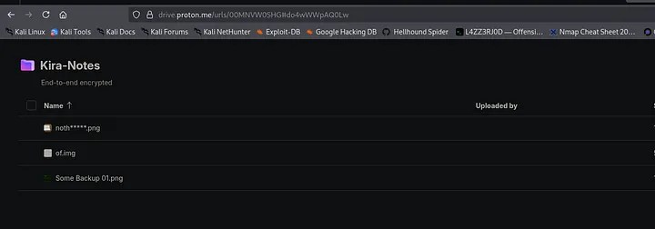
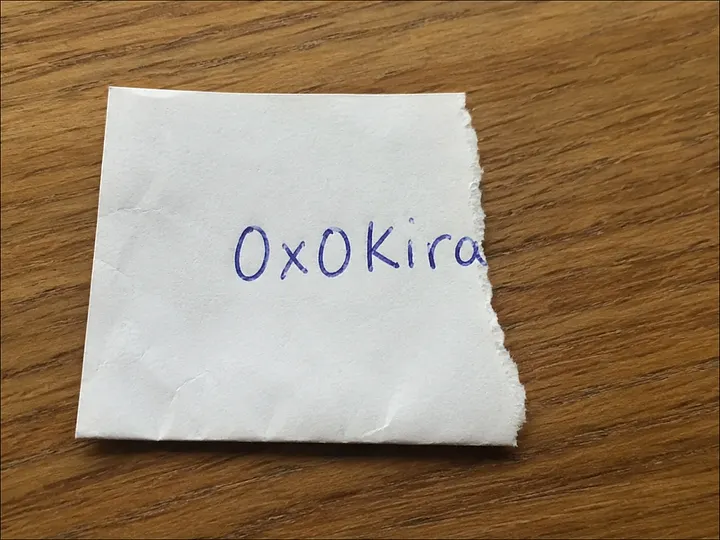
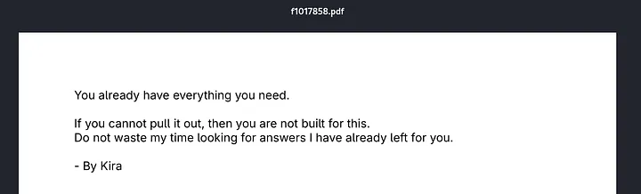
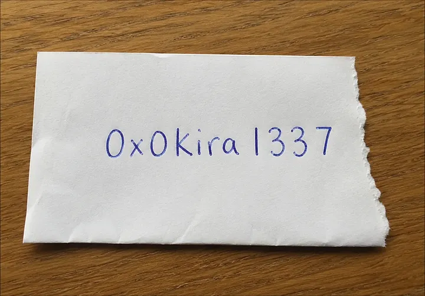

# NoHackNoCTF 2026 — `Kira-Notes` Writeup

- **Author:** Efe Şahinbaş
- **GitHub Repository:** [MacallanTheRoot/ctf-writeups](https://github.com/MacallanTheRoot/ctf-writeups/)

**Category:** Forensics  
**Challenge file:** `places.sqlite`  
**Flag format:** `NHNC{...}`

---

## Challenge Description

> Please don't use AI to solve this question  
> Learn instead of letting the agent do it :(  
> What is the category? Once you play it, you will know.

The challenge started with a single Firefox artifact: `places.sqlite`. At first, it looked like a normal browser-history database, but the browsing trail led to a GitHub repository, a Proton Drive share, and finally a disk image. The actual flag was not inside the browser database directly; it had to be recovered from deleted data inside the disk image.

---

## Summary

The solution chain was:

```text
places.sqlite
    -> Firefox browsing history
    -> GitHub repository: Kira-Notes
    -> Proton Drive share
    -> of.img disk image
    -> deleted/recovered ZIP + PNG + PDF
    -> password reconstruction
    -> encrypted ZIP extraction
    -> flag.txt
```

Final flag:

```text
NHNC{n0w_y0u_kn0w_h0w_t0_f0r3ns1c_0x00000Easyyyyyyyyy}
```

---

## 1. Inspecting `places.sqlite`

Firefox stores browsing history, page titles, visit information, bookmarks, and other metadata inside SQLite databases. The most relevant table in this case was `moz_places`, which contains visited URLs and their titles.

I started by opening the database and listing interesting URLs:

```bash
sqlite3 places.sqlite
```

```sql
SELECT id, url, title
FROM moz_places
ORDER BY id;
```

The normal browsing entries were not important. The interesting part was the trail pointing to GitHub, Proton Drive, and a small web archive:

```text
25|https://github.com/UmmItKin|UmmItKin (UmmIt Kin, Leon) · GitHub
26|https://github.com/UmmItKin?tab=repositories|UmmItKin (UmmIt Kin, Leon) / Repositories · GitHub
27|https://github.com/ICEDTEACTF|ICEDTEA CTF · GitHub
28|https://github.com/orgs/ICEDTEACTF/repositories|ICEDTEACTF repositories · GitHub
29|https://github.com/UmmItKin/Kira-Notes|GitHub - UmmItKin/Kira-Notes · GitHub
43|https://proton.me/|Proton: Privacy by default
44|https://drive.proton.me/urls/00MNVW0SHG#do4wWWpAQ0Lw|Kira-Notes - Proton Drive
45|http://151.158.224.74:31337/|Kira Notes // Retro Hacker Archive
46|http://151.158.224.74:31337/wtfbro|404 Not Found
47|http://151.158.224.74:31337/#guestbook|Kira Notes // Retro Hacker Archive
48|http://151.158.224.74:31337/dl/eyeswap.bin|404 Not Found
49|http://151.158.224.74:31337/dl/notebook-crack.tgz|404 Not Found
```

This changed the direction of the challenge. The database was not the final artifact; it was a map.

---

## 2. Following the GitHub and Proton Drive Trail

The GitHub repository did not directly contain the flag. Its main purpose was to lead to the Proton Drive share.



The Proton Drive folder contained three important files:

```text
noth*****.png
of.img
Some Backup 01.png
```

The partially redacted PNG was important because it showed a handwritten fragment that looked like a password.



At this point, the main target became `of.img`, because it was the largest and most likely forensic artifact.

---

## 3. Analyzing `of.img`

After downloading the disk image, I checked its layout. The image contained a Linux filesystem, and the partition offset could be calculated from the sector start.

```bash
fdisk -l of.img
mmls of.img
```

The partition started at sector `2048`. Since each sector is `512` bytes, the mount offset was:

```text
2048 * 512 = 1048576
```

I mounted the filesystem read-only:

```bash
sudo mkdir -p /mnt/of
sudo mount -o ro,loop,offset=1048576 of.img /mnt/of
```

Then I checked the user download directory:

```bash
find /mnt/of/home/ctf/Downloads -ls
```

The live filesystem contained several zero-byte files:

```text
I
will
not
let
you
see
it
```

Read in order, the files form the sentence:

```text
I will not let you see it
```

This was a clear hint that the useful files had been deleted or hidden in unallocated space.

---

## 4. Recovering Deleted Files

Since the visible filesystem was almost empty, I moved to file carving. The goal was to recover deleted files from unallocated space.

```bash
photorec of.img
```

PhotoRec recovered several useful files:

```text
f0541698_flag.zip
f0541700.png
f1017858.pdf
report.xml
```

The exact recovered names may vary depending on the recovery session, but the important files were:

```text
a password-protected ZIP
a recovered PNG
a recovered PDF note
```

I also checked for flag references in the raw image:

```bash
strings -a of.img | grep -i flag
```

This confirmed that a `flag.txt` reference existed somewhere in the image.

---

## 5. Reading the Recovered Note

The recovered PDF contained a message from Kira:



```text
You already have everything you need.

If you cannot pull it out, then you are not built for this.
Do not waste my time looking for answers I have already left for you.

- By Kira
```

This confirmed that no external bruteforce or unrelated guessing was needed. The password and the encrypted archive were already present in the recovered artifacts.

---

## 6. Reconstructing the ZIP Password

The PNG from Proton Drive showed the first part of the password, while the recovered PNG revealed the full value.



The reconstructed password was:

```text
0x0kira1337
```

This matched the visual clues from the two PNG files.

---

## 7. Extracting the Encrypted ZIP

The recovered ZIP was password-protected, so I used the reconstructed password with `7z`:

```bash
7z x -p0x0kira1337 f0541698_flag.zip
```

After extraction, the archive produced `flag.txt`.

```bash
cat flag.txt
```

Output:

```text
NHNC{n0w_y0u_kn0w_h0w_t0_f0r3ns1c_0x00000Easyyyyyyyyy}
```

---

## 8. Flag

```text
NHNC{n0w_y0u_kn0w_h0w_t0_f0r3ns1c_0x00000Easyyyyyyyyy}
```

---

## Notes and Takeaways

This challenge was built around a realistic forensic chain rather than a single hidden string. The important lesson was to follow artifacts in sequence:

```text
1. Browser history gave the external trail.
2. The Proton Drive share provided the disk image and password fragment.
3. The mounted filesystem showed a taunting sentence but not the real files.
4. File carving recovered deleted artifacts.
5. The password was reconstructed from image evidence.
6. The encrypted ZIP contained the final flag.
```

The main mistake would be stopping after mounting the image. The live filesystem was intentionally misleading; the real evidence was in deleted data.
