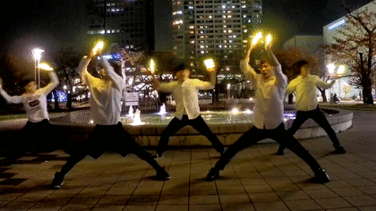
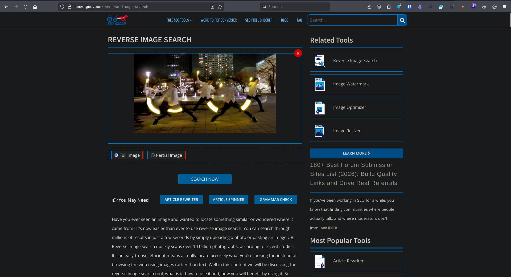
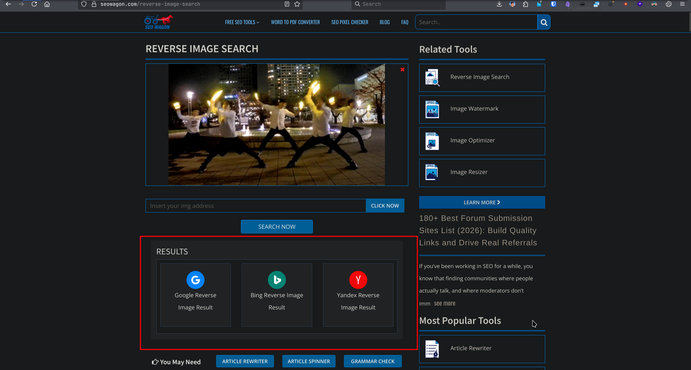
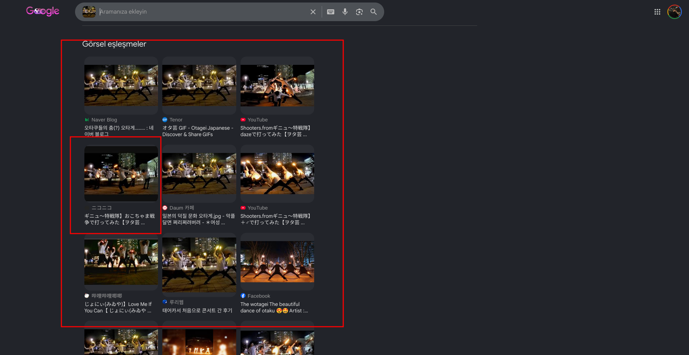
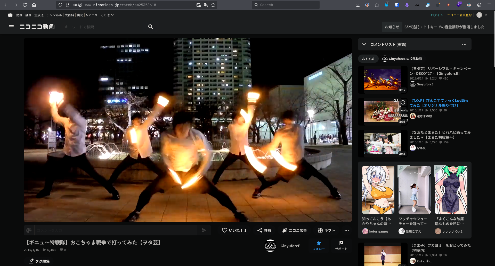
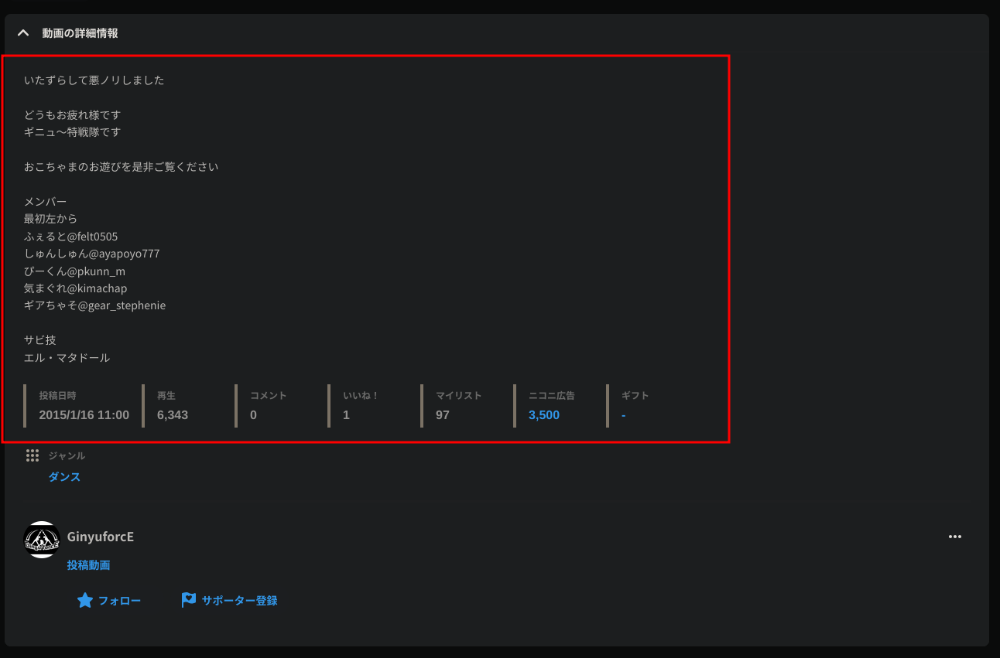

# NoHackNoCTF 2026 — `Wotagei` Writeup

- **Author:** Efe Şahinbaş
- **GitHub Repository:** [MacallanTheRoot/ctf-writeups](https://github.com/MacallanTheRoot/ctf-writeups/)

**Category:** OSINT  
**Challenge file:** `wota.gif`  
**Goal:** Find the Instagram username of the person indicated by the challenge.  
**Flag format:** `NHNC{instagram_username}`

> Note: This public version leaves the final personal account handle redacted. Replace the placeholder with the accepted username when publishing in a CTF-only context where sharing the flag is permitted.

---

## Challenge Description

The challenge provided a short GIF showing a group performing wotagei, a Japanese idol-fan dance style using glow sticks. The task was to find the Instagram account of the person specified by the prompt.

Because the input was a cropped GIF rather than a direct source link, the solution required reverse image search and source verification.



---

## Summary

The key idea was to identify the original video or a repost of the same frame. A reverse image search led to multiple exact and near-exact matches. Among the results, a Japanese video page on Niconico matched the provided GIF. The video description contained a member list with social media handles. After comparing the source video with the challenge GIF and checking the listed accounts, the correct Instagram username was obtained.

Final flag format:

```text
NHNC{<accepted_instagram_username>}
```

---

## 1. Reverse Image Search

I started by uploading the provided GIF/frame to a reverse image search tool.



The tool returned options for multiple engines, including Google, Bing, and Yandex.



Since wotagei is strongly associated with Japanese internet culture and idol fan performances, I focused first on Japanese-looking results and exact visual matches.

---

## 2. Google Visual Matches

Google returned several visually similar matches using the same scene: a group of performers in white shirts, black pants, and glow sticks, standing in front of a fountain at night.



The important observation was that the same frame appeared across several sources. This meant the GIF was likely taken from a public video, repost, or derivative clip rather than being an isolated image.

Among the results, the Niconico result looked especially relevant because:

- the title was in Japanese,
- the thumbnail matched the provided GIF,
- the platform commonly hosts this kind of dance/performance content,
- the result appeared to be a video rather than a random repost.

---

## 3. Finding the Source Video

Opening the Niconico result showed a video with the same performers, same location, same lighting, and same glow-stick choreography.



The matching title was:

```text
【ギニュー特戦隊】おこちゃま戦争で打ってみた【ヲタ芸】
```

At this point, the source video was confirmed because the visual details aligned with the challenge GIF:

- same group formation,
- same night-time plaza/fountain background,
- same white shirts and black pants,
- same glow-stick movement pattern,
- same building layout in the background.

---

## 4. Checking the Video Description

After confirming the correct video, I checked the video description. This was the most useful part of the source page because it listed the members and their social media handles.



The description contained a member list written in Japanese. The useful section was the list of performers and their handles.

From there, I compared the challenge target with the people visible in the GIF and tested the relevant candidate handle against the flag format.

---

## 5. Building the Flag

The challenge requested the Instagram username in this format:

```text
NHNC{their_instagram_username}
```

After validating the correct candidate, the flag becomes:

```text
NHNC{<accepted_instagram_username>}
```

---

## Root Cause of the Solve

This challenge was not about extracting metadata from the GIF. The decisive step was finding the original source video through reverse image search and then using the video description as the authoritative source for the performer handles.

The solve path was:

```text
1. Upload the GIF/frame to reverse image search.
2. Inspect exact visual matches.
3. Prioritize Japanese/Niconico results because of the wotagei context.
4. Confirm the original video by matching background and choreography.
5. Read the video description.
6. Map the listed member handles to the challenge target.
7. Submit the username in NHNC{...} format.
```

---

## Notes

When writing up OSINT challenges involving real people, it is better to avoid exposing unnecessary personal details. For a public blog post, include only the minimum needed for the CTF solution, and consider redacting the handle if the event rules do not require public flag disclosure.
