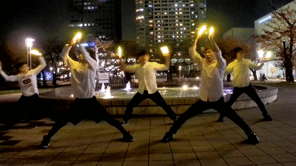
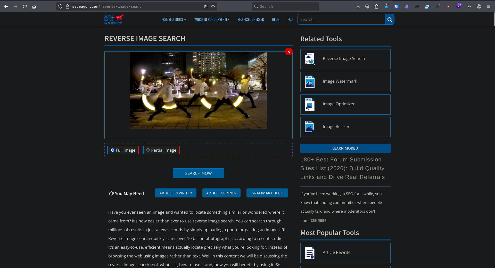
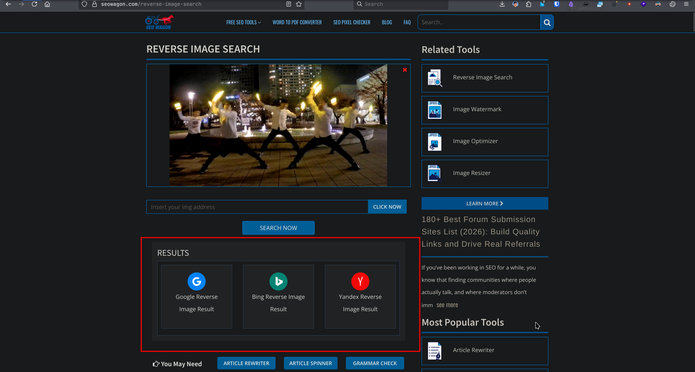
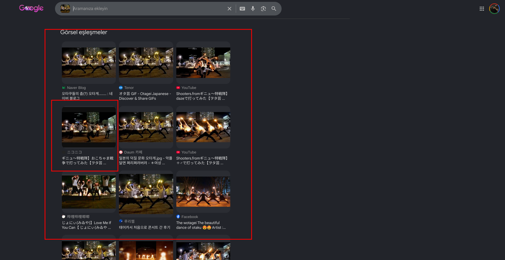
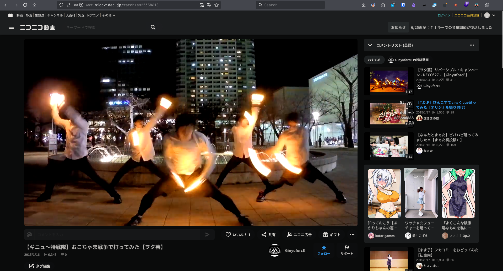
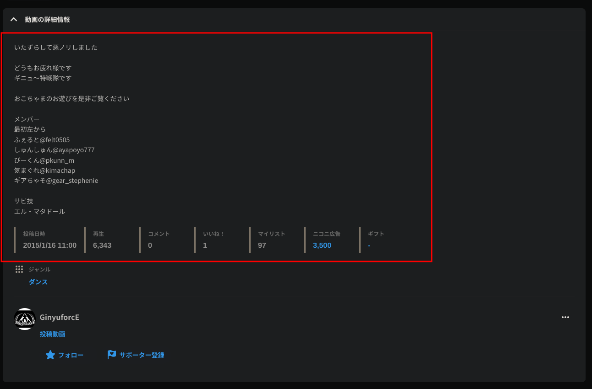

# NoHackNoCTF 2026 — `Wotagei` Writeup

- **Yazar:** Efe Şahinbaş
- **GitHub Deposu:** [MacallanTheRoot/ctf-writeups](https://github.com/MacallanTheRoot/ctf-writeups/)

**Kategori:** OSINT  
**Challenge dosyası:** `wota.gif`  
**Hedef:** Challenge’da belirtilen kişinin Instagram kullanıcı adını bulmak  
**Flag formatı:** `NHNC{instagram_username}`

> Not: Bu public sürümde final kişisel hesap kullanıcı adı redacted bırakılmıştır. CTF bağlamında flag paylaşımı serbestse placeholder alanını kabul edilen kullanıcı adıyla değiştirebilirsin.

---

## Challenge Açıklaması

Challenge bize wotagei yapan bir grubun kısa GIF’ini veriyordu. Wotagei, özellikle Japon idol/fan kültürüyle ilişkili, glow stick kullanılarak yapılan bir performans tarzıdır. Bizden istenen şey, prompt’ta belirtilen kişinin Instagram hesabını bulmaktı.

Verilen dosya doğrudan kaynak link değil, kırpılmış/kısa bir GIF olduğu için çözüm tersine görsel arama ve kaynak doğrulama üzerine kuruldu.



---

## Kısa Özet

Çözümün ana fikri, GIF’in alındığı orijinal videoyu veya aynı kareyi barındıran güvenilir bir kaynağı bulmaktı. Tersine görsel arama sonucunda aynı sahneye ait birden fazla eşleşme çıktı. Bu sonuçlar arasında Niconico üzerindeki Japonca video, verilen GIF ile doğrudan eşleşiyordu. Video açıklamasında grup üyeleri ve sosyal medya hesapları listelenmişti. Kaynak video doğrulandıktan sonra listedeki hesaplar challenge hedefiyle karşılaştırıldı ve doğru Instagram kullanıcı adı elde edildi.

Final flag formatı:

```text
NHNC{<accepted_instagram_username>}
```

---

## 1. Tersine Görsel Arama

İlk adım olarak verilen GIF’i/kareyi tersine görsel arama aracına yükledim.



Araç, Google, Bing ve Yandex gibi farklı arama motorları üzerinden sonuçlara bakma seçeneği verdi.



Wotagei kültürü özellikle Japon internet kültürüyle bağlantılı olduğu için önceliği Japonca görünen ve görsel olarak birebir eşleşen sonuçlara verdim.

---

## 2. Google Görsel Eşleşmeleri

Google tarafında aynı sahneye ait birden fazla görsel eşleşme çıktı. Bu eşleşmelerde beyaz gömlekli, siyah pantolonlu ve glow stick kullanan bir grubun gece vakti bir meydan/fıskiye önünde performans yaptığı görülüyordu.



Buradaki önemli nokta, aynı karenin birden fazla kaynakta görünmesiydi. Bu durum, GIF’in rastgele bir görsel değil; büyük ihtimalle public bir video, repost veya kısa klipten alınmış olduğunu gösteriyordu.

Sonuçlar arasında Niconico bağlantısı özellikle dikkat çekiciydi çünkü:

- başlık Japoncaydı,
- thumbnail verilen GIF ile eşleşiyordu,
- platform bu tür dans/performans içerikleri için yaygın kullanılıyordu,
- sonuç rastgele bir görsel değil, video kaynağı gibi görünüyordu.

---

## 3. Kaynak Videoyu Bulmak

Niconico sonucunu açtığımda aynı performansın yer aldığı videoya ulaştım. Videodaki kişiler, mekan, ışıklandırma ve glow stick hareketleri challenge GIF’iyle eşleşiyordu.



Eşleşen video başlığı şuydu:

```text
【ギニュー特戦隊】おこちゃま戦争で打ってみた【ヲタ芸】
```

Bu noktada kaynak video doğrulanmış oldu. Çünkü şu detaylar challenge GIF’iyle aynıydı:

- aynı grup dizilimi,
- aynı gece çekimi,
- aynı meydan/fıskiye arka planı,
- aynı beyaz gömlek ve siyah pantolon kombinasyonu,
- aynı glow stick hareket paterni,
- arka plandaki bina ve çevre düzeni.

---

## 4. Video Açıklamasını Kontrol Etmek

Doğru videoya ulaştıktan sonra açıklama kısmını kontrol ettim. Çözüm için en kritik bilgi burada bulunuyordu, çünkü açıklamada performanstaki üyeler ve sosyal medya hesapları listelenmişti.



Açıklamada Japonca bir üye listesi yer alıyordu. Buradaki asıl değerli bilgi, performansa katılan kişilerin kullanıcı adlarıydı.

Bu aşamada challenge’ın hedeflediği kişi, GIF’teki konumu ve video açıklamasındaki üyelerle karşılaştırıldı. Ardından ilgili aday kullanıcı adı flag formatına göre test edildi.

---

## 5. Flag’i Oluşturmak

Challenge bizden Instagram kullanıcı adını şu formatta istemişti:

```text
NHNC{their_instagram_username}
```

Doğru aday doğrulandıktan sonra flag şu formata dönüştü:

```text
NHNC{<accepted_instagram_username>}
```

---

## Çözümün Temel Mantığı

Bu challenge’da asıl mesele GIF metadata’sı çıkarmak değildi. Belirleyici adım, tersine görsel arama ile orijinal kaynak videoya ulaşmak ve video açıklamasını güvenilir kaynak olarak kullanmaktı.

Çözüm zinciri şu şekildeydi:

```text
1. GIF’i/kareyi tersine görsel aramaya yükle.
2. Görsel olarak birebir eşleşen sonuçları incele.
3. Wotagei bağlamı nedeniyle Japonca/Niconico sonuçlarına öncelik ver.
4. Arka plan, kıyafet ve koreografi eşleşmesiyle kaynak videoyu doğrula.
5. Video açıklamasındaki üye listesini oku.
6. Listedeki kullanıcı adlarını challenge hedefiyle eşleştir.
7. Kullanıcı adını NHNC{...} formatında gönder.
```

---

## Notlar

Gerçek kişilerin yer aldığı OSINT writeup’larında gereksiz kişisel bilgi paylaşmamak daha sağlıklıdır. Public bir blog yazısında yalnızca CTF çözümü için gerekli minimum bilgiyi vermek ve etkinlik kuralları açıkça flag paylaşımına izin vermiyorsa kullanıcı adını redacted bırakmak daha güvenli bir yaklaşımdır.
